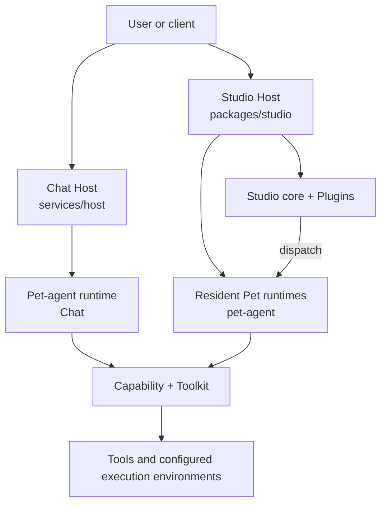

# Architecture

> **Status: current architecture guide.** This page describes design choices
> and implementation boundaries, not a settled list of project principles. See
> the [principles discussion](../zh-CN/concepts/principles-discussion.md). For
> type-level contracts, follow the links into [Reference](../reference/index.md).

[简体中文](../zh-CN/concepts/architecture.md)

PinPawo Agent is an open-source, local-first agent stack. It separates
orchestration, task authority, tool execution, user review, and durable state so
each concern can evolve independently and remain observable.

For the terminology behind this design, start with [Core Concepts](core-concepts.md).

## Design goals

The project aims to build a reliable single-Agent mechanism and use it as the
foundation for Studio. The following current design choices support that goal;
they do not by themselves establish that reliability has been achieved:

1. **Keep users in control.** Local-machine Toolkit operations and browser
   sessions stay on the machine that runs the agent; review policy can stop
   risky work for approval.
2. **Make authority visible.** Capabilities declare their Toolkit dependencies
   statically, so the available tool surface is explicit per task.
3. **Support real, multi-step work.** Checkpoints, structured events, and
   session snapshots let a client recover after disconnection or review.
4. **Organize and extend capabilities.** Capabilities describe tasks and bind
   typed Toolkits that provide tools and their policies.
5. **Organize work with Studio.** Studio uses Pet runtimes and Plugins; Plugins
   provide a way to add business behavior.

## System map



Chat Host and Studio Host are independent composition entries. Both use Host
assembly and the `pet-agent` mechanism; Studio Host creates resident Pet runtimes
and connects them to Studio. The diagram shows roles, not a shared runtime instance.

Each Host resolves configuration and assembles Capabilities and Toolkits. A
Toolkit may declare execution-environment dependencies; the Host injects RS
instances, which can be shared by multiple Toolkits. See the
[RS contract](../reference/extensions/toolkit-rs.md). Agent orchestration remains
in `packages/pet-agent`; host-specific integrations live in `services/` and
`toolkits/`.

The Agent-side ownership relationship is
`Host -> Agent Runtime -> Capability -> Toolkit`: a Capability selects Toolkits,
and Tool definitions belong to a Toolkit.
RS is an injected dependency, not a Toolkit-owned runtime. The orchestrator and
subagent lanes are internal to Agent. See the accepted
[domain and assembly constraints](../design/host-agent-capability-toolkit.md).

## Main packages

| Area | Location | Responsibility |
|---|---|---|
| Contracts | `packages/agent-contracts/` | Shared request, event, review, and run contracts. |
| Orchestration | `packages/pet-agent/` | Agent graph, Capability planning, lane isolation, review integration, and execution records. |
| Session state | `packages/agent-session/` | Client-neutral session model, reducers, versioned snapshots, and parsers. |
| Collaboration | `packages/studio/` | Studio Host, dispatch, read-only per-Pet dispatch-queue observation (including admission state), and extension contracts (`@pinpawo/studio-core`). |
| Studio distribution | `services/studio/` | Complete `@pinpawo/studio` CLI and six foundational Plugin dependencies. |
| Local host | `services/host/` | CLI, configuration, runtime composition, and local transports. |
| Terminal UI | `services/tui/` | OpenTUI client and packaged distribution. |
| Tool integrations | `toolkits/`, `plugins/`, and `services/host/` | Toolkit definitions and their execution-environment integrations. |

## Request lifecycle

```text
1. A client submits a user request to the local host.
2. The host composes a registry from enabled Capabilities and available Toolkits.
3. The orchestrator may answer directly. When it delegates work, the following steps apply.
4. Each lane can use only the Toolkits declared by its Capability.
5. Tool policy may proceed, request human review, or block the operation.
6. The completed result returns to the main conversation.
7. The session projection reports durable and live state to connected clients.
```

This flow is designed to avoid two common failure modes: broad tool access
granted through prompt wording, and UI clients trying to reconstruct durable
state from a transient tool-event stream.

## State ownership

| State | Owner | Boundary rule |
|---|---|---|
| Conversation messages and pending continuation | LangGraph checkpoint, when configured | Durable authority for resume and review. |
| Current client view | Session projection | A materialized view; never a second conversation store. |
| Capability scratch work | Subagent lane | Private to the selected unit of work. |
| Delegated result evidence | Checkpoint messages | Typed execution records preserve the delivery; private tool transcripts stay in the child graph. |
| Local configuration | Local host and workdir | Resolved before a runtime is created. |
| Studio dispatch delivery | Per-Pet invocation queue | Queue is process-local; active thread and checkpoint continuity belong to the resident Pet's Agent Session. |

## Deployment modes

| Mode | Use when | Entry point |
|---|---|---|
| Interactive local agent | A person works directly in the terminal. | `pinpawo tui` |
| Local server | Another local UI or app needs an HTTP/WebSocket host. | `pinpawo server` |
| JSONL stdio | A process integration needs one transport-safe peer. | `pinpawo server --stdio` |
| Studio | A Plugin-driven control plane dispatches work across resident Pets. | `pinpawo-studio [--pet-port <port>]` |

## Extension model

The project has two complementary extension concerns:

- Add a **Studio Plugin** to contribute business behavior through Studio. A
  Plugin may also provide Toolkits; the Host assembles Capabilities separately.
- Add a **Capability** when the extension defines a new user-facing task,
  instructions, and a fixed Toolkit allowlist.
- Add a **Toolkit** when the extension supplies reusable tools, availability
  checks, execution-environment dependencies, operation metadata, or review policy.

A Capability can be authored as `CAPABILITY.md` with optional narrowly scoped
code for `lifecycle.finalize`, or defined in code. A Toolkit is typed code. See the
[Capability / Toolkit V2 contract](../reference/extensions/capability-toolkit.md) and
[Capability directory protocol](../reference/extensions/capability-directory.md).
See [Studio](../studio/index.md) for Plugin composition and boundaries.

## Security and privacy boundaries

- Browser automation can use an extension and Native Messaging bridge with
  origin checks and an explicit local registration flow.
- Toolkits carry review guidance and tools may require human authorization.
- Local configuration, credentials, and checkpoint storage stay outside client
  protocol payloads.
- Private Capability transcripts stay in their child graph; Root conversation
  records the delegated result rather than copying the full tool history.

The old Capability Artifact Pipeline, unused state index and Channel attachment
API are retired. Execution records use only the current schema; historical
checkpoint compatibility is not retained during self-testing unless explicitly
requested. See the [retirement notes](../reference/extensions/capability-toolkit.md#7-旧-artifact-pipeline-退役).
This cleanup does not add file publication or discovery.
The proposed replacement remains in the [Session Artifacts draft](../design/agent-runtime/session-artifacts.md).

For Browser-specific setup and limits, read
[Chrome extension browser](../guides/browser-bridge.md).

## Next steps

- [Getting started](../guides/getting-started.md) — run the local host.
- [Core Concepts](core-concepts.md) — understand the user-facing model.
- [API reference](../reference/api/index.md) — programming and protocol
  reference.
- [Studio](../studio/index.md) — multi-agent coordination and configuration.
