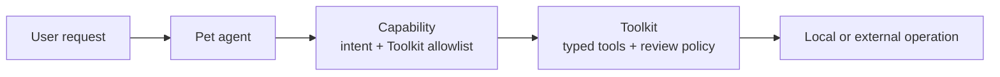

# Core Concepts

[简体中文](../zh-CN/concepts/core-concepts.md)

PinPawo Agent aims to build a reliable single-agent mechanism in `pet-agent`
and use that foundation to organize Studio. Studio Plugins make business behavior
pluggable; Capability and Toolkit organize and extend the agent's abilities.

Reliability is a goal under continuous development, not a claim that the current
system has achieved it. Review, checkpoints, recovery, and other mechanisms are
current design choices that can evolve as the project learns from real work.
The [principles discussion](../zh-CN/concepts/principles-discussion.md) records
questions still being aligned.

<a id="what-the-project-gives-you"></a>

## How the pieces fit

- **Pet agent** is the single-agent runtime. It handles a request and can use
  Capabilities and Toolkits within the configured authority.
- **Studio** organizes work across Pet runtimes. Its Plugins provide an extension
  point for business behavior; some Plugins instead provide infrastructure.
- **Capability and Toolkit** organize agent abilities. A Capability describes
  focused work and declares the Toolkits it uses; a Toolkit supplies tools and
  their policies. A Plugin may supply Toolkits; the Host separately selects
  Capabilities for each Pet.

For current package and runtime boundaries, see [Architecture](architecture.md).

## The core vocabulary

| Concept | Meaning | Why it matters |
|---|---|---|
| **Host** | The product or process boundary that resolves configuration, selects Capability and Toolkit definitions, owns Agent runtimes, and supplies execution-environment dependencies. | It keeps machine, transport, and lifecycle concerns outside the Agent graph. |
| **Pet agent** | One configured Agent runtime with models, Capabilities, compiled Toolkit bindings, and state. | It is the unit that receives an invocation and produces a user-visible result. |
| **Capability** | A focused, delegable unit of work with instructions and a fixed Toolkit allowlist. | It makes routing and tool authority inspectable instead of implicit in a large prompt. |
| **Toolkit** | A typed family of tools, instructions, availability checks, review guidance, and optional execution-environment dependencies. | It groups reusable tool implementations and their policies. |
| **Subagent lane** | The short-lived private execution context used for one selected Capability or general task. | It keeps task-specific reasoning isolated from the main conversation. |
| **Human review** | The interrupt-and-resume boundary for actions that require user authorization or input. | Approval is a runtime contract, not a convention hidden in an instruction. |
| **Checkpoint** | Persisted LangGraph state for messages and pending continuation, when a checkpointer is configured. | It supports resume and recovery. |
| **Session projection** | The client-neutral view of a checkpoint plus current runtime facts. | TUI and remote clients share one presentation contract without each rebuilding state. |
| **Studio** | The multi-Pet dispatch substrate: a Pet registry, read-only per-Pet dispatch-queue observation, and an in-process Plugin event bus. | It organizes work across Pet runtimes. |
| **Studio Plugin** | A Studio extension that can dispatch work, exchange events, own domain state, and optionally provide Toolkits. | It allows business behavior to be added through a Plugin. |
| **Workdir** | The local scope for runtime configuration, Studio state, and relative tool paths. | It prevents unrelated projects from sharing runtime state accidentally. |

## Canonical detail by concept

This page intentionally gives each concept one short definition. Use the
following pages when you need a contract or implementation boundary:

| Concept area | Canonical detail |
|---|---|
| Capability and Toolkit authority | [Capability / Toolkit contract](../reference/extensions/capability-toolkit.md) |
| Toolkit execution-environment dependencies | [Toolkit RS contract](../reference/extensions/toolkit-rs.md) |
| Review and authorization reuse | [Events and human review](../reference/api/events-and-review.md) and [Authorization matcher](../reference/runtime/authorization-matcher.md) |
| Checkpoint, session, snapshot, and timeline | [Session projection](../reference/runtime/session-projection.md) |
| Legacy artifact extension changes | [Retirement notes](../reference/extensions/capability-toolkit.md#7-旧-artifact-pipeline-退役) |
| Workdir and runtime configuration | [Workdir configuration](../reference/runtime/workdir.md) |
| Multi-agent coordination | [Studio](../studio/index.md) |

<a id="the-two-extension-boundaries"></a>

## Capability and Toolkit extension boundaries



1. A **Capability** describes the task and names the Toolkits it is allowed to
   use.
2. A **Toolkit** provides tools or shared instructions and their operational policy.

Capability instructions can be authored as Markdown or code, while executable
tools and their policies are defined in typed Toolkits.

The Capability Artifact Pipeline and the old Channel attachment field are retired;
see the [retirement notes](../reference/extensions/capability-toolkit.md#7-旧-artifact-pipeline-退役)
and the [current message API](../reference/api/studio.md#channel-messages-and-addressing).
Explicit file publication and download remain a [Session Artifacts proposal](../design/agent-runtime/session-artifacts.md).

A Host creates and retains Agent runtimes and supplies the execution-environment
dependencies Toolkits declare. Multiple Toolkits can share an environment
dependency. See the [Toolkit RS contract](../reference/extensions/toolkit-rs.md)
and the accepted [Host / Agent / Capability / Toolkit relationships](../design/host-agent-capability-toolkit.md).

## The execution model

A user request does not automatically grant every tool to every model call.
The runtime follows this shape:

```text
request
  -> Entry Answer replies directly or routes an executable goal
  -> Run Supervisor selects and steers the Capability plan
  -> selected work runs in an isolated lane
  -> Toolkit tools execute under their declared policy
  -> optional human review interrupts and resumes the run
  -> result is handed back to the main conversation
```

The important invariant is that the main conversation receives the completed
result, not the entire private scratchpad and tool transcript. This limits
context growth while keeping the final answer grounded in completed work.

## Checkpoints, sessions, and timelines

These terms are deliberately different:

- A **checkpoint**, when configured, persists runtime state for continuation.
- A **session projection** is a client-safe view of session and runtime facts.
- A **timeline** is a UI structure that can show live operations between
  checkpoints.

The [Host session projection](../reference/runtime/session-projection.md) defines
the current protocol and replacement rules in detail.

## Studio collaboration

Studio is for work that benefits from several specialized agents. It owns the
shared dispatch channel: a Pet registry, read-only per-Pet queue observation,
and an in-process plugin event bus. The resident runtime owns the queue and gate.
A planner, task board, or scheduler is a Plugin or Pet concern; Studio does not
store task state, infer completion, or own shared knowledge.

Studio does not become a second tool executor or a shared private scratchpad.
Read the [Studio overview](../studio/index.md) for the current runtime boundary.

## Where to go next

- [Architecture](architecture.md) — how the packages and runtime boundaries fit
  together.
- [Getting started](../guides/getting-started.md) — install the CLI, configure a model,
  and run the local agent.
- [Capability / Toolkit V2 contract](../reference/extensions/capability-toolkit.md) —
  build a Capability or Toolkit.
- [Host session projection](../reference/runtime/session-projection.md) — build a
  client or understand recovery behavior.
