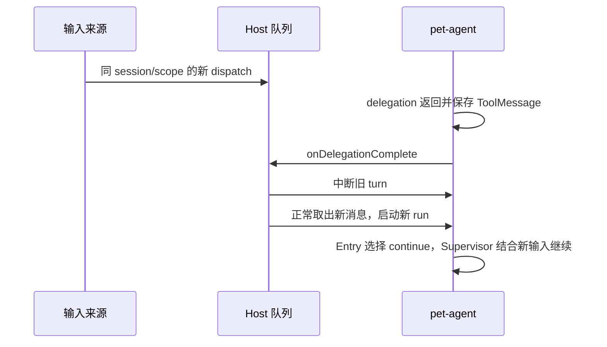

# 执行期间的新输入与 Studio system interrupt

状态：实现草稿，待 review；本地行为验证通过，尚未部署到 Toolbox。

## 问题与目标

Pet 正在委派工作时，后续消息留在 Host 队列，当前 Supervisor 无法看到。
本次让普通新输入在 delegation 返回后接入，并提供立即中断当前执行的可信
Studio dispatch 选项。两条路径均复用现有 Abort、Entry 和 `continue`，保留计划与
真实执行记录，不另建子任务恢复状态。

## 接入与归属

Root 在 Capability ToolMessage 提交后的独立 `delegationBoundary` 节点调用可选的
`onDelegationComplete` invocation hook。pet-agent 不认识 Studio、Channel 或 Host 队列。
Host 检查相同 Pet、显式 session、完整 scope 的待处理 dispatch；只有匹配输入才
中断旧 turn。尚未消费的新输入仍由既有队列取出，进入正常的新 run。

新 run 的 Entry 读取新消息和保存的计划，由模型选择 `continue`、新规划或直接回答。
`continue` 把现有计划绑定到新 run，Supervisor 从 Boundary 接回。已返回的 delivery
按计划项身份保留，可以验收；未返回的执行不算完成，不自动重放产生副作用的工具。

Hook 不取出消息、不追加用户正文、不写 checkpoint，也不构造 `continue` 工具调用。
这样保留唯一的队列消费入口。原 invocation 结束为 interrupted；下一 invocation
拥有后续回复，避免一次公开消息被两个 invocation 重复发布。

## 立即中断

可信的 in-process Studio dispatch 可请求 `delivery: 'interrupt'`。Host 先接收新输入，
再匹配当前 session、scope 与 request ID，使用既有取消入口中断执行。待旧执行真正
结算后，队列正常继续。其他 Channel、session 和旧 request 不得被打断。

该控制不等于模型消息的 system role。新内容仍以原来源进入消息历史，不提升 Pet
发言的授权。公共 wire dispatch 不接受该可信控制和 session/scope 字段。

取消绑定当前实际 request ID，不保存供后续 turn 使用的中断标记。若实际运行尚未
建立，输入保持排队；不会预先取消尚未开始的 turn。

如果取消与原生人工审批相遇，真实 interrupt、原 dispatch 归属及公告快照继续保留。
新输入等待明确审批，不生成审批答案、不以普通输入调用原生 resume。

## Channel 的提示

Channel decision LLM 选中接收者后，在已有的 dispatch JSON envelope 中增加固定
`contextHint`，建议通过 `channel_read_context` 或显式配置的 `channel_context`
Capability 读取最新相关消息，结合已有成果判断是否仍需行动。

提示来自 Channel 插件固定代码；路由模型的自由文本 reason、群公告和完整消息历史
不作为提示拼入用户消息。公告仍使用原有 system context provider。显式 @ 和
schedule/trigger 保持各自已有输入形式；本次不扩展 Pet 无 @ 消息的自动路由。

## 验证与限制

验证普通 delegation 返回后接入、立即取消、同目标连续输入、跨 session/scope 隔离、
原生审批竞态、公开回复归属，以及 continuation 后真实结果可验收、工具不重放。
跨包测试使用真实 Host、Channel provider、checkpoint 和 graph，只替换模型响应。
实现证据见 [Root 边界测试](../../../packages/pet-agent/src/agent/orchestrator/runtime/graph.test.ts)、
[Host 输入与审批竞态测试](../../../services/host/src/host/residentPetIncomingInput.test.ts)
和 [Channel 跨包测试](../../../tests/studio-e2e/src/channelIncomingInput.test.ts)。

Host 队列仍是内存队列。本设计不承诺进程崩溃后恢复未执行的 dispatch，也不自动
合并内容相似的多条消息。delegation 结束之后才到达的普通输入仍可能等待下一边界；
需要立即干预时使用明确的 interrupt 控制。
