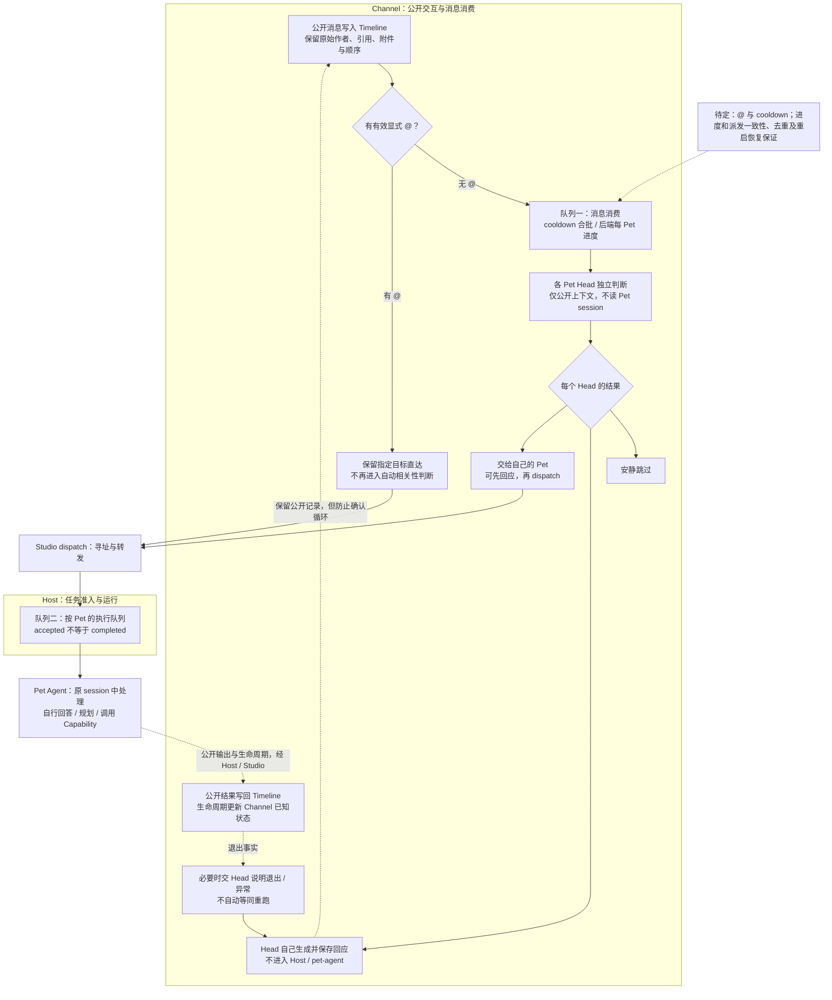
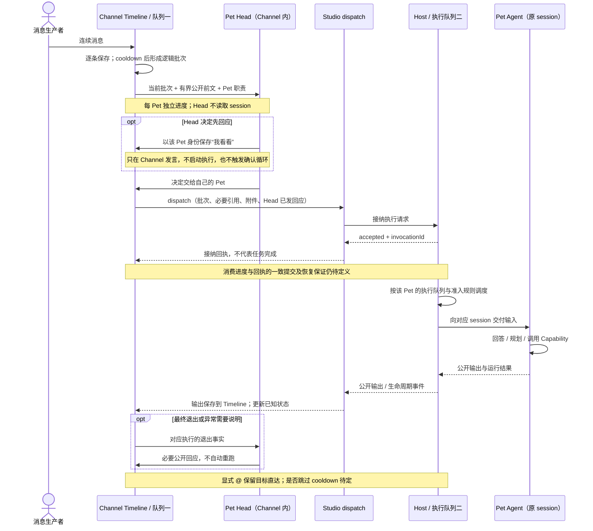

# Channel Timeline 消费与 Pet Head

> 状态：目标设计草稿，尚未实现；不是当前运行契约。
> 更新：2026-11-09
> 本文统一记录两个队列的流程、时序和领域边界。图中的待定项仍需在实现中明确，不能视为既定保证。

## 目标与范围

Channel 接收并保存公开消息。没有显式 @ 时，各 Pet 在 Channel 中的 Head 独立判断新消息是否与自己有关。
需要真正执行时，Channel 才通过 Studio dispatch 把任务交给对应 Pet 的 Host。

**Channel 消费消息，Host 消费执行任务。** Head 已判断、Host 已接纳和 Pet 已完成是三个不同事实。

本文拟逐步替代 [Channel 路由](channel-routing.md) 中统一选择一个 Pet 的机制，不在旧 Router 前后再叠一轮决策。
当前实现仍以代码、测试和现有文档的明确状态为准。

## 当前基础与本次变化

核对基线：`main` 的 `c2410ea87e24357844e6959af08f5ec9aaae27c2`。

- Timeline 已持久保存原始消息，并以 `sequence` 排序和分页。
- 有效 @ 走现有 `dispatchPet`；无 @ 可由统一 Router 为单条消息选择一个 Pet 或不派发。
- 旧 Router 通过 `collectChannelRoutingState` 调用 `petSessions.snapshot`，只向模型投影运行状态，
  不把私有对话交给模型。但该采样链仍深入了 Host session，本次不沿用。
- Host 已有按 Pet 的运行准入、执行队列和生命周期事件。Studio dispatch 的部分幂等记录保存在进程内。
- 本次新增的是 Channel 的合批、每 Pet 消费进度和 Head；不是给 Host 增加另一套 Channel 队列。

实现来源：
[消息入口与派发](../../../plugins/channel/src/channelPlugin.ts)、
[现有 Router](../../../plugins/channel/src/channelRouting.ts)、
[旧状态采样](../../../plugins/channel/src/channelRoutingState.ts)、
[消息与 session 存储接口](../../../plugins/channel/src/store/channelStore.ts)、
[Studio dispatch](../../../packages/studio/src/createStudio.ts)、
[Host 协调器](../../../services/host/src/host/residentPetCoordinator.ts)。

## 领域边界

| 层 | 负责 | 不负责 |
|---|---|---|
| Console | 发消息、显示 Timeline 和消费/执行结果 | 权威消费进度、浏览器定时派发 |
| Channel | 公开消息、成员、合批、各 Pet 消费进度、Head 判断与公开回应 | Capability 选择、执行计划、审批恢复 |
| Studio | Pet 寻址、dispatch、事件通道、模型能力装配 | Channel 批次与 Head 规则 |
| Host | Pet 任务接纳、执行队列、session、运行与审批机制 | 判断哪条 Channel 消息值得关注 |
| pet-agent | 接到任务后的回答、规划与 Capability 调用 | Channel cooldown、消费游标或 Head 生命周期 |
| Capability / Toolkit | 具体工作与工具执行 | Channel 消息分配 |

模型实例或配置可以由 Studio 装配层提供。Head 调用模型不等于进入 Host 的 Pet 执行流程。
现有 [Channel 模型](channel-model.md)、[寻址与执行](channel-addressing-and-execution.md) 和
[Host 边界](../agent-runtime/resident-pet-host-ports.md) 继续约束成员、session 与执行权限。

## Pet Head 的定义

**Pet Head 是同一个 Pet 在某个 Channel 的注意力和交互入口。** 它理解一批新公开消息，
判断是否与自己有关，决定保持安静、直接回应，或把消息交给自己的 Pet 执行。
执行最终退出或异常时，它还可以承接必要的公开说明。

Head 属于 Channel，不是新的 Pet、独立执行 Agent 或 Supervisor。它不替其他 Pet 分配任务，
不选择 Capability，不制定计划，不调用业务工具，也不维护第二份 Pet 私有会话。
原 pet-agent 的 Entry 继续负责接到执行输入后的处理，不迁移到 Channel。

首版输入保持轻量：

- 对应 Pet 的成员身份、名称和简短职责。可先复用 `routing.pets`，并区分 Channel 内分工与 Pet 本身身份。
- Channel 公告/协作提示、当前消息批次，以及有界的公开前文。
- 引用和附件的结构化信息，不因合批丢失作者、消息 ID 或原始顺序。
- Channel 通过现有生命周期事件已经知道的必要执行状态；未知仍是未知。

Head **不读取 Pet session、checkpoint、私有计划、审批载荷或完整 Capability 配置**。
公开输出本来就回到 Timeline，不需要再从 session 复制。没有公开回复不能推出空闲、失败或完成。
只有真实验收证明输入不足时，才讨论补充最小数据来源，不预先新增 Host 上下文接口。

每个 Head 只决定自己的结果：

- 跳过：本批次不需要自己回应或执行。
- 直接回应：Head 在 Channel 层生成并保存公开文本，不启动 Host 或 pet-agent。
- dispatch：交给自己的 Pet；可以先在 Channel 回应，例如“我看看”，再派发执行。

多个 Head 可以都判断相关，也可以全部跳过。不要把多个 Head 再收敛为“选一个胜者”。
先行回应只表达已关注或准备处理，不能冒充 Host 已接纳、执行开始或任务完成。

## 队列一：Channel 消息消费

### 生产与合批

1. 生产者通过正常入口保存每条消息，Timeline 立即保留作者、正文、引用、附件和原始顺序。
2. 后端以 cooldown 把连续待判断消息组成逻辑批次；合批不改写或删除原始消息。
3. 各 Pet 的 Head 独立消费适用批次，不从共享 Timeline 抢走消息，也不需要复制 N 份原始内容。
4. 后端维护 `(channelId, petId)` 的消费进度；Console 不因断开、重连或页面关闭成为消费权威。

实现应让同一个 Head 的消费推进有序，并允许不同 Pet 独立判断；一个 Head 失败不应卡住其他 Pet。
批次处理中的新消息留给后续批次，不能随着旧批次游标一起被越过。
进度表达“已判断到哪里”，不表达“已经执行完成”。

### 显式 @

显式 @ 保留用户指定目标，走指定 Pet 的 dispatch 路径，跳过其他 Head 的自动相关性判断。
同一条已寻址消息不能又被无 @ 消费路径重复派发。

**@ 是否绕过 cooldown 仍待定。** 这个选择与是否打断运行中的任务无关；
接纳、排队、运行时机和审批边界仍由 Host 决定，不由 Channel 强制抢占。
非法 @ 仍应报告寻址问题，不把解析失败后的消息当成普通无 @ 输入重新分配。

### 自己的消息与防循环

- Pet 执行输出默认不触发自己；不会作为新指令再派给产生它的同一 Pet。
- Head 的先行回应也是 Timeline 中以对应 Pet 为作者的消息，但它没有经过 Pet session。
  后续 dispatch 必须带上这次已发回应，让执行 Pet 知道已经对外说过什么。
- 先行确认与必要的退出说明不得引发 Head 相互确认的无限循环；需要保留可信的消息来源信息，
  不能只靠显示名、正文或模型“记得不要回复”。
- 新消息引用 Pet 以前的发言时，仍保留理解新指令所需的引用及附件。
- 对同一执行会话已经产生的输出做增量输入去重，不全局隐藏 Pet 自己的历史。
  Timeline 和 Pet 主动读取历史的完整性不改变。

## 队列二：Host 执行任务

Head 只有在决定进入执行时，才复用现有 Channel → Studio dispatch → Host 路径。
继续绑定该 `(Channel, Pet)` 原有 session；新 session 的分配/创建属于真实执行入口，不为 Head 判断预先创建。
多个 Pet 可以分别收到任务；同一个 Pet 的执行仍遵守 Host 的共享运行槽和准入规则。

- Head 已判断：这批消息已经过该 Head 的相关性与回应判断。
- `accepted`：Host 已接纳任务，可能仍在排队。
- 运行中：生命周期事件确认执行开始。
- 等待审批、取消、失败、完成：分别记录，不互相代替。

Head 直接回应不产生执行任务。已先回应但派发失败时，应如实报告交接失败，不能把回应当作成功接纳。

## 流程图

## 端到端时序图

示例为无 @、一个 Head 先回应后进入执行。其他 Head 同时独立判断，可以跳过、回应或各自执行。

## 执行退出与异常

Host 报告执行事实，Channel 根据 `invocationId` 和对应 Channel/Pet 关联事件，
只在需要公开说明时再交给 Head。不要让一次执行内部的普通 Capability 结果全部绕回 Head。

等待审批不等于执行失败，也不授权恢复审批；取消不等于失败；失败不意味着自动重跑。
Head 不猜测未报告的根因，不绕过审批或重新授予权限。迟到、重复和不属于当前执行的事件需要关联校验。

## 持久化与恢复边界

Timeline 持久化和消费进度落库，并不能自动保证 dispatch 不丢、不重复。
例如：派发前推进进度可能丢工作；Host 接纳后、进度提交前崩溃可能造成重复派发。
Head 先行回应也存在“已保存回应、尚未接纳任务”的中间状态。

实现阶段必须明确并测试这些窗口。复用现有 Studio/Host 幂等入口，不另建平行的全局可靠执行队列。
没有验证 Host 任务与幂等记录的重启行为之前，不宣称端到端 exactly-once 或可靠自动重放。
不必为了首版引入消息中间件；是否需要 outbox 或持久派发记录，要由所选择的恢复保证决定。

## 分阶段开发与验收

### 1. Channel 消费基础

- 后端维护每 Channel–Pet 消费进度，逻辑合批不改写原始 Timeline。
- 验证连续消息合批、批次中新增消息、并发推进、重复事件、断开 Console 和成员变化。
- 明确批次上限、cooldown 等待上限，以及新成员/退出后重入的起始进度。
- 切换过程不得让旧 Router 与新路径对同一消息重复派发。

### 2. Channel 内 Pet Head

- 以每 Pet 的结构化判断替代统一选一个目标；支持 0、1、多 Pet 相关。
- 支持跳过、Head 直接回应、可选先回应后 dispatch；保持有界模型调用，不增加业务工具循环。
- 移除自动判断链的 `petSessions.snapshot` 依赖，测试 Head 判断/回应不创建或读取 session。
- 保留 @、成员校验、作者身份、引用、附件、session 绑定和审批边界。
- 验证同 Pet 自输出去重、Head 回应随任务传递，以及多 Pet 不互相确认循环。
- 使用真实模型样例评估误响应、漏响应、多 Pet 协作和收口；不按固定提示词措辞判通过。

### 3. 执行退出与恢复验收

- 关联生命周期事实，区分完成、取消、等待审批、失败和派发失败。
- 验证重复/迟到事件、Head 超时或非法输出、先回应后派发失败，以及进度写入失败。
- 对真实持久存储和 Host 重启做故障窗口测试，写清实际恢复与去重保证。

每阶段同步实现事实、文档状态和检查结果；文档草稿发布不等于实现完成，也不授权合并或部署。

## 尚未定案

1. @ 是否绕过 cooldown；普通消息的 cooldown 默认值、最大批量与最长等待。
2. Head 错误/超时后的重试与进度推进策略，避免静默丢弃或无限重试。
3. 新 Pet 加入、成员退出/重入、配置关闭/重新开启时，从哪里开始消费。
4. 消费进度、Head 已发回应与 dispatch 的一致性策略及重启恢复保证。
5. 必要状态投影的最小字段和生命周期关联方式；没有事实的字段保持未知。

这些选择应在对应实现 PR 中写清。未定案不改变已经对齐的领域边界和轻量 Head 目标。
