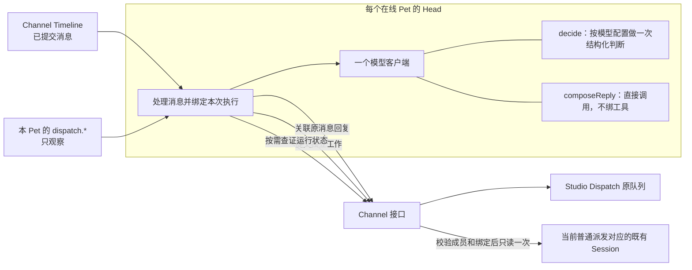
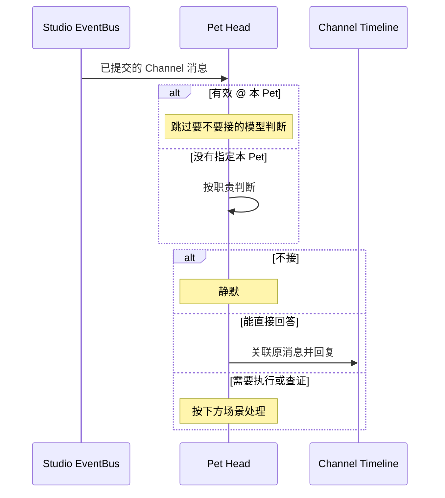
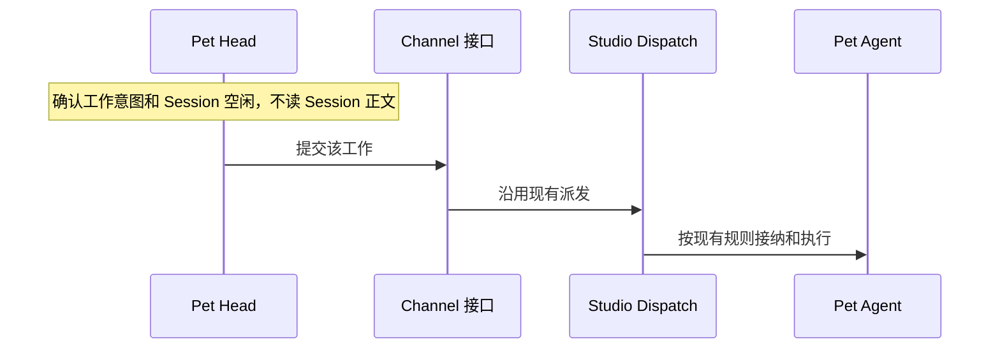
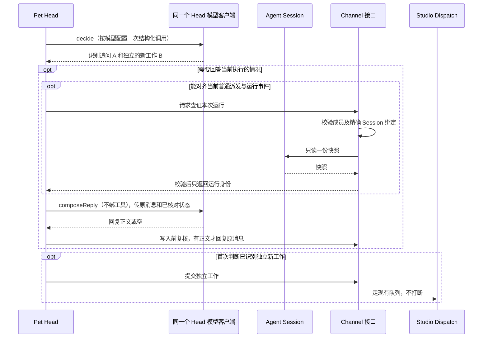
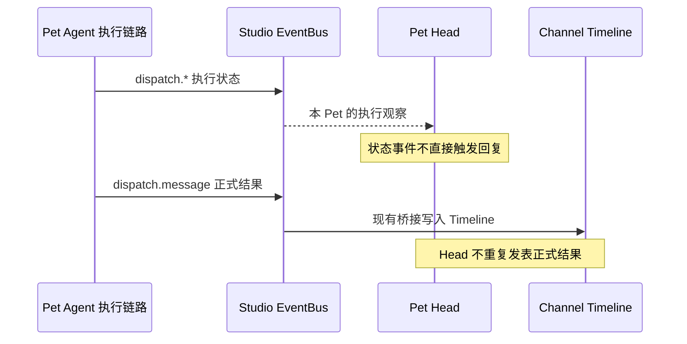

# Pet Head：判断、派发与反馈

状态：Head 组装和单客户端复用已实现，待评审。不改变 Channel、Studio Dispatch 或 resident Pet Agent 的职责。

首版（`a9b59036`）曾由 Studio Host 装配两个订阅，并分别懒建判断和写回复的模型客户端。现在每个在线 Pet 的 Head 自己管理两个订阅，共用一个懒加载的模型客户端。Host 只提供依赖，Pet 实例仍决定何时启动和停用 Head；不新增 Head 开关。

## 1. 总体结构

- **Channel Timeline → Studio EventBus → Head。** Human 和 Pet 写入同一条 Timeline；Channel 只在消息提交后发布 `channel.message.created`。在线 Pet 实例由自己的 Head 订阅 `source=channel, topic=channelId`，过滤自己发的消息。Channel 不替 Head 选消费者；live bus 不向离线 Head 补投。
- **Head → Channel port → Studio Dispatch → resident Pet Agent。** Head 做判断；现有 Channel port 校验成员和原消息、绑定 Session、传递附件和去重键；Studio 和 resident Pet 负责接纳、排队、执行与审核。
- **resident Pet Agent → Studio EventBus → 本实例的 Head。** Studio 已发布以 Pet 实例为 topic 的 `dispatch.*` 生命周期；Head 只观察本实例的执行状态，不因事件发消息。事件只用来绑定当前运行，不保留回复内容。查证经 Channel 授权后走既有只读 Session 入口。

**Head 的职责边界。** Head 随 Pet 实例启动，自己订阅归属 Channel 的 Timeline 和本实例的派发生命周期；停用时取消进行中的判断或回复并释放两个订阅。Host 不为每条消息逐步转交。Channel 仍负责原消息的校验、回复和派发入口；Studio 仍负责接纳；Session 仍提供现有只读入口。

## 2. 谁接，怎么处理

先确定这条消息是否归本 Pet。**当前消息里的有效 `@Pet` 已经明确指定了响应者**，只跳过「要不要接」的模型判断，不绕过 Head，也不意味着要派发或打断。没有明确点名本 Pet 时，Head 用职责和 Channel 上下文判断；不接就静默。能直接答的就直接答，不读 Session、不启动 Agent。

**先判断该不该接，再由 Head 运行代码按实际状态选路。** 沿用[原时序图](https://github.com/pinpawo/pinpawo-agent/blob/fec24f028d54ecb6b214881269b220739a2eab11/docs/design/studio/pet-head-mechanism.md#L51-L127)：模型只判断是否接下、能否直接回答、是否有独立工作；不决定读 Session 还是派发。运行代码负责查证。读完只写回复，不恢复第二次调度判断。

| 场景 | 行为 |
| --- | --- |
| 派发槽空闲（开放、无占用、无待派发项），需要 Agent | 直接提交独立工作，不读 Session、不再调模型。若也问到以前的 A，立即回复可说明无法确认，不把空槽当成 A 已完成。 |
| 只问执行状态，当前没有可核对的普通派发 | 不读其他 Session；只能说明无法确认，不派发。其他范围、会话占用、目标不明均不是空闲的证据。 |
| 本 Pet 的普通派发正在执行，用户问进度 | 核对同一次执行，只回复「正在运行」或「无法确认」。 |
| 审批后续跑，不在普通派发槽 | 首版不读 Session；进度无法确认。审批行为不变。 |
| 已有执行，用户明确加一件独立工作 | 先尝试查证同一次执行，再将独立工作提交现有队列；不因查证失败取消它。不打断当前执行，也不主动播报无关进度。 |
| 用户要求停止或修改正在跑的任务 | 首版不新增聊天打断，也不注入新材料。已有停止入口不变；Head 不声称已停止或已修改。 |

## 3. 忙时只查证、写回复

模型层只有一个客户端：`decide` 按已解析的模型配置做一次结构化调用（例如 DeepSeek 官方 Flash / Pro 用 JSON mode，Anthropic 默认用工具调用），无效输出不补救、不重试、不切换格式。`composeReply` 直接调用同一个未绑定工具的客户端，只写回复。初判没有 `readProgress`；没有独立工作或回复时，不要求模型编造意图或正文。是否读取由 Head 核对本 Pet 的普通派发槽、归属 Channel、Session 和到达消息时的运行身份后决定。

需要查证时，Head 对齐本 Pet 当前的普通派发与运行事件。Channel 验证当前成员及精确 Session 绑定后，只读一次 Session，只返回运行身份供核对。传给 `composeReply` 的只有原消息、「正在运行／无法确认」和能对应到此次运行的公开来源；不看计划、工具或 Session 正文，也不查历史结果或待排任务。Head 使用 LangChain 的回复文本；写入前复核当前执行是否已换。回复描述的是查证时的状态，不与 Channel 写入做跨系统原子提交。

例如「@Pet，A 做到哪了？另外帮我做 B」：第一次判断认出 B 是独立工作；Head 只核对 A 的运行状态，再尝试回复；B 仍由原有 Studio 队列接纳。查不到 A 就如实说，不把 A 的状态套到 B 上。「如果 A 没做完就换 B」并非独立授权：即使查不到 A，也不把 B 另行提交。

## 4. 分场景时序

### 4.1 指定对象、静默与直接回复

### 4.2 空闲派发

### 4.3 忙时追问与独立追加

### 4.4 执行通知与正式结果

## 5. 首版验收边界

以下用例验证 Head 的行为，以及每次 Pet 激活只有一对订阅和一个按需创建的模型客户端。

- 被明确点名和主动接下消息，后续使用同一条 Head 路径。静默、直接答复和空闲派发都不读 Session 正文。
- 忙时同一条追问只查一次；只问进度不派发，独立追加只提交一次；写回复的步骤没有调度权。
- 只核对普通派发的状态，审批后续跑不采样，A 换成 B 前后不混用状态。Head 的回复和 Agent 的正式结果各走原链路。
- 不新增队列、通用工具循环、自动或聊天打断、主动长时提醒、历史事件重放或失败恢复。Channel、Studio Dispatch 和 Pet Agent 原有职责不变。
