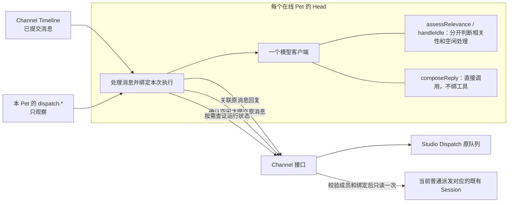
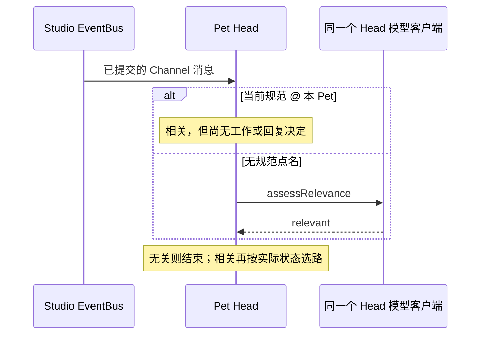
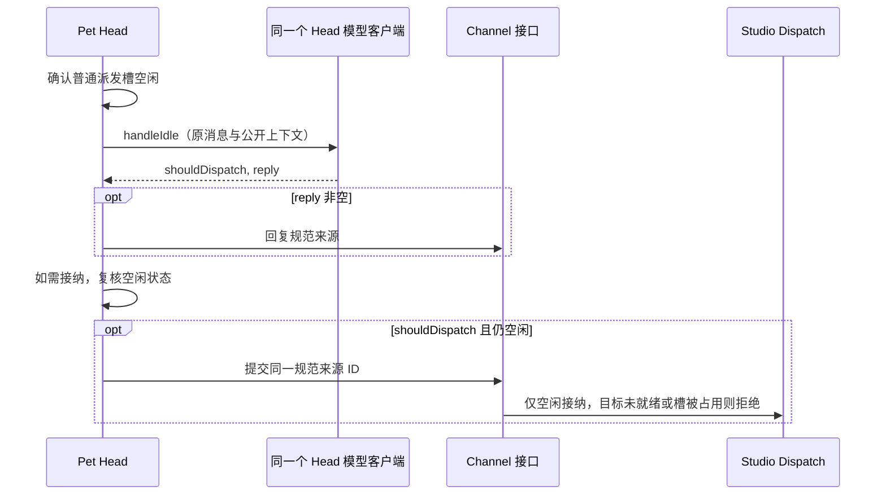
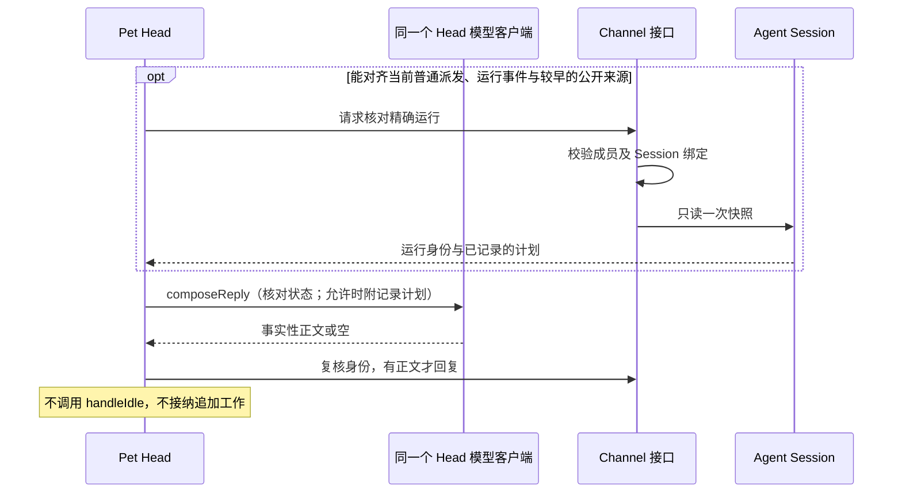
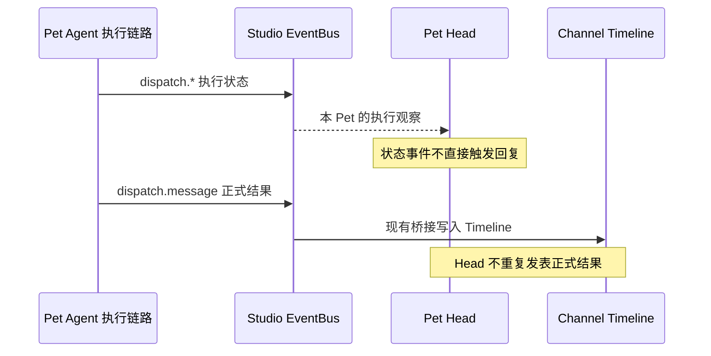

# Pet Head：判断、派发与反馈

状态：Head 组装和单客户端复用已实现，待评审。不改变 Channel、Studio Dispatch 或 resident Pet Agent 的职责。

首版（`a9b59036`）曾由 Studio Host 装配两个订阅，并分别懒建判断和写回复的模型客户端。现在每个在线 Pet 的 Head 自己管理两个订阅，共用一个懒加载的模型客户端。Host 只提供依赖，Pet 实例仍决定何时启动和停用 Head；不新增 Head 开关。

## 1. 总体结构

- **Channel Timeline → Studio EventBus → Head。** Human 和 Pet 写入同一条 Timeline；Channel 只在消息提交后发布 `channel.message.created`。在线 Pet 实例由自己的 Head 订阅 `source=channel, topic=channelId`，过滤自己发的消息。Channel 不替 Head 选消费者；live bus 不向离线 Head 补投。
- **Head → Channel port → Studio Dispatch → resident Pet Agent。** Head 做判断；现有 Channel port 校验成员和原消息、绑定 Session、传递附件和去重键；Studio 和 resident Pet 负责接纳、排队、执行与审核。
- **resident Pet Agent → Studio EventBus → 本实例的 Head。** Studio 已发布以 Pet 实例为 topic 的 `dispatch.*` 生命周期；Head 只观察本实例的执行状态，不因事件发消息。事件只用来绑定当前运行，不保留回复内容。查证经 Channel 授权后走既有只读 Session 入口。

**Head 的职责边界。** Head 随 Pet 实例启动，自己订阅归属 Channel 的 Timeline 和本实例的派发生命周期；停用时取消进行中的判断或回复并释放两个订阅。Host 不为每条消息逐步转交。Channel 仍负责原消息的校验、回复和派发入口；Studio 仍负责接纳；Session 仍提供现有只读入口。

## 2. 相关性先行，实际状态选路

本节替代 `458f3952` 及之前的动作初判说明；[此前的时序图](https://github.com/pinpawo/pinpawo-agent/blob/fec24f028d54ecb6b214881269b220739a2eab11/docs/design/studio/pet-head-mechanism.md#L51-L127)作为历史设计保留，不代表当前可接纳行为。

当前消息中的服务端解析 `@Pet` 建立相关性，跳过模型的相关性判断；它不是工作授权，也不意味着必须回复或派发。没有规范点名时，`assessRelevance` 只返回 `{ relevant: boolean }`，不含动作、回复或任务重写。相关的消息才进入后续状态分支；不相关则静默。Human 消息与 Pet Agent 的正式消息使用同一语义判断。Head 自动回复仍显示在 Timeline 中，但不触发其他 Head；用户引用它发出的新消息照常处理。

| 运行代码核对的状态 | 后续行为 |
| --- | --- |
| 派发槽确认空闲：开放、无占用、无待派发项 | `handleIdle` 判断原消息的真实语义，返回 `{ shouldDispatch: boolean, reply: string | null }`。允许直接回答、独立工作、先回应再工作或不做任何事。裸点名不自动变成工作。 |
| 本 Pet 普通派发正在执行 | 查证同一次执行，仅经 `composeReply` 写事实性回复或保持空回复；不调用空闲判断、不接纳追加工作。 |
| 其他范围、会话占用、目标不明、审批后续跑或状态不可确认 | 不当作空闲；只能事实性说明无法确认或静默，不派发。 |

空闲分支在提交前再次核对普通派发槽；这只是初筛。Channel 和 Host 准备好原消息和调用上下文后，resident 检查准确绑定的 Session 是否在等待审核，并在同一处同步检查并占用现有派发槽。槽已被占用、有待派发项、检查期间有其他接纳活动或目标未就绪时，拒绝 Head 请求，不入队、不打断；其他来源仍走原有的接纳规则。先回应再工作的回复关联同一条规范来源，先尝试发布，再独立尝试接纳；回复不是已接纳、已开始或已完成的证明。取消阻止剩余动作。

派发不让 Head 摘写任务。Channel 按源消息 ID 取同一 Channel 的已提交记录，复用现有 `channel_message` 放入 Agent 的原生输入。保留正文、作者、点名、附件和一层明确引用，不附带 Head 判定或整段 Timeline。引用和历史只是背景，不构成额外授权。

## 3. 模型与事实边界

每个 Head 共用一个懒加载模型客户端。`assessRelevance` 与 `handleIdle` 分别使用严格声明 `pet_head_relevance`、`pet_head_idle`，按解析后的 `structuredOutputMethod` 调用，各阶段不补救、不重试、不切换格式。结构化输出合法不代表语义正确。`composeReply` 使用同一未绑定工具的客户端，只输出正文或空，不提供调度决定。

相关性确定后，忙时才读取本 Pet 的普通派发槽并固定当前运行。派发的公开来源必须在同一 Channel、早于追问的 Timeline 序号，且不能与显式引用冲突。Channel 验证成员及精确 Session 绑定后，只读一次 Session，以请求身份核对运行。来源或运行无法核实时，只能说无法确认；不把请求身份与 graph run/task 绑定。有核对结果时，回复可引用绑定 Session 已记录的计划条目状态和简短描述。已完成条目不代表整个任务完成；活动条目可能等待评审；记录计划可能早于本次执行，不能证明正在做哪一步。没有计划则只报核对到的运行状态。禁止从交付正文、Session 对话或原始工具输出推断进度。

稳定规则、格式与 Pet 角色在前，公开 Channel 上下文按固定顺序传入。历史仅取当前消息之前最近 10 条；窗口之外的显式引用仅补一次，当前消息和规范成员点名在最后，不重复发送。缓存指标与语义准确率分开。相关的忙时消息可调用一次正文生成，即使最后没有正文；相关性结果本身不代表是否要回复。写入前再次核对执行身份；查证和 Channel 写入不是跨系统原子事务。

例如「@Pet，A 做到哪了？另外帮我做 B」始终相关，但若正在跑 A，只能查证并回复，不把 B 接入队列；空闲时才判断 B 的独立工作语义。「如果 A 没做完就换 B」不能因查不到 A 而直接接纳 B。停止、替换和注入不属于本轮 Head 权限，显式 Stop 和 review 接口保持原状。

## 4. 当前分场景时序

### 4.1 相关性

### 4.2 已确认空闲

### 4.3 忙或状态不明

### 4.4 执行通知与正式结果

## 5. 首版验收边界

以下用例验证 Head 的行为，以及每次 Pet 激活只有一对订阅和一个按需创建的模型客户端。

- 被明确点名和主动接下消息，后续使用同一条 Head 路径。相关性判断和空闲处理不读 Session 正文。
- 忙时同一条追问只查一次；只问进度和独立追加都不派发；写回复的步骤没有调度权。
- 只核对普通派发，审批后续跑不采样。运行状态仍只属于核对的那次执行；进度只读绑定 Session 的现有计划，不读交付正文。Head 的回复和 Agent 的正式结果各走原链路。
- 不新增队列、通用工具循环、自动或聊天打断、主动长时提醒、历史事件重放或失败恢复。Channel、Studio Dispatch 和 Pet Agent 原有职责不变。
