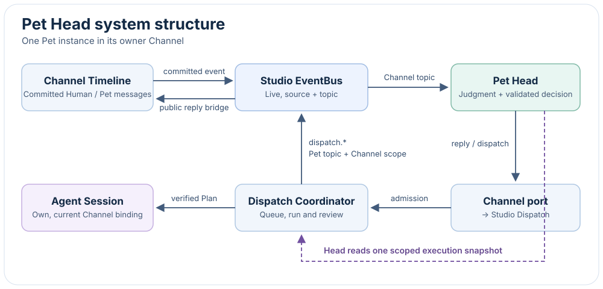
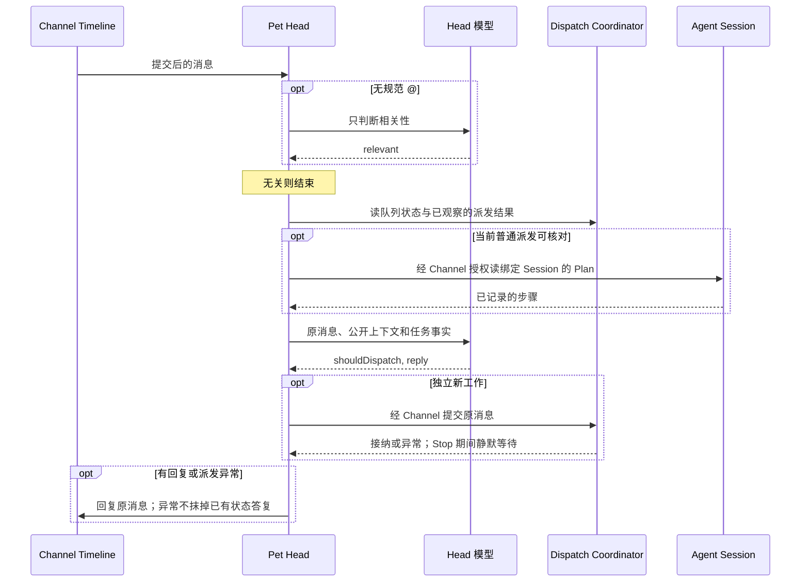

# Pet Head：判断、派发与反馈

## 1. 结构和职责

- **Channel Timeline → EventBus → Head。** Head 跟随 Pet 实例，订阅自己的 Channel。离线不补投，自己的消息和其他 Head 的自动回复不触发新判断。
- **Head → Studio Dispatch → Host Dispatch Coordinator。** Head 只判断是否提交独立工作。Channel 校验成员和绑定，交付原消息、附件和一层明确引用。Coordinator 负责接纳、FIFO 和 Stop 等待；Head 不复制队列规则。
- **Coordinator + Agent Session → `readSession` → Head。** 队列和生命周期回答「这次派发是什么状态」，Session 的 Plan 回答「记录了哪些步骤」。Head 组装两种事实，不从 Agent 内部消息猜进度。

## 2. 两阶段

1. **相关性判断。** 规范 `@Pet` 直接通过；其他消息用 `assessRelevance` 判断，只返回 `{ relevant }`。无关则结束，不读 Session。
2. **派发判断。** 先取得已绑定 Session 的任务事实，再单次调用 `decideDispatch`，返回 `{ shouldDispatch, reply }`。回复和提交不是互斥分支。模型不改写原任务，不根据忙闲决定是否允许提交。

`readSession` 是运行时准备上下文的只读入口，不增加模型工具调用。仅关联本 Pet、Channel、绑定 Session 及可见的原消息。进行中的普通派发最多核对一次 Session，若运行切换则不携带旧 Plan。已排队只报未开始，挂起等待与完成区分。完成必须有真实生命周期事件，不从队列消失推断。首版复用现有事件，在线实例只保留最近十项状态，不保存消息原文、不补历史；超出窗口或重启后无法查证就明说。正式交付仍经现有 Channel 桥接，不让 Head 再发布一次。

## 3. 场景与边界

| 用户消息 | 处理 |
| --- | --- |
| 「A 做到哪了？」 | 只按事实回答。A 排队不说成在跑，已完成不读取新任务的 Plan。 |
| 「A 到哪了？另外做 B。」 | 一次判断产生 A 的回复和 B 的提交。B 未接纳时不声称已排队。 |
| 「如果 A 没做完就换 B。」 | 不是普通独立派发；不把未知当失败，本次不接入 Stop 或替换工具。 |
| 「你是分析员吗？」 | 直接回复，不因当前有工作而被替换为进度。 |

同一个懒加载客户端分别使用 `pet_head_relevance`、`pet_head_dispatch` 两个结构化约定。系统规则和角色前置；Channel 历史保留最近十条和显式引用。不加模型重判、额外回复生成或队列控制。首次 Session 注册仍由 Host 的 idle-only 规则接纳。
