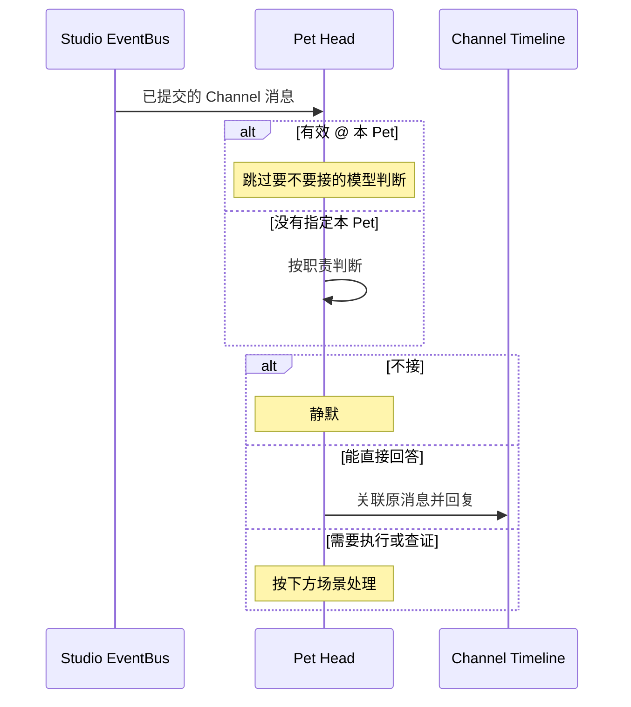
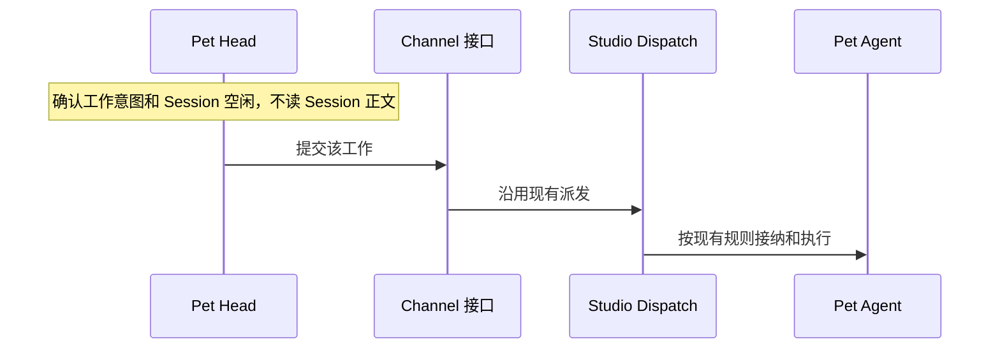
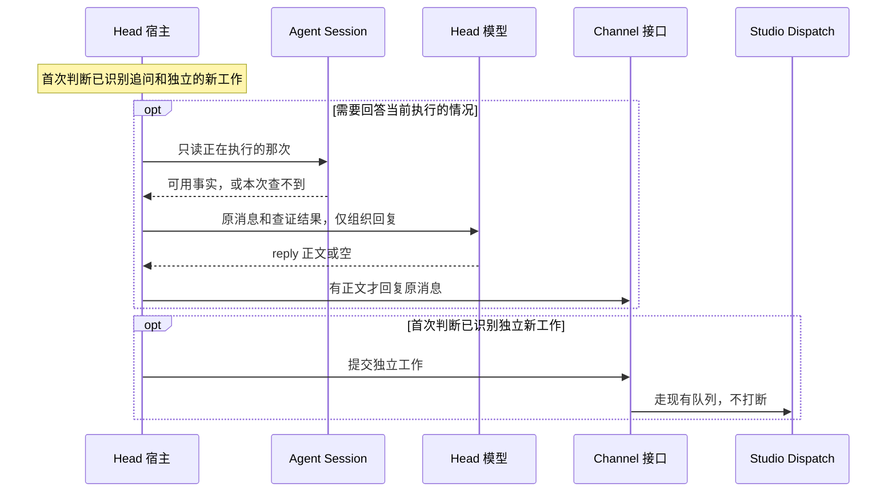
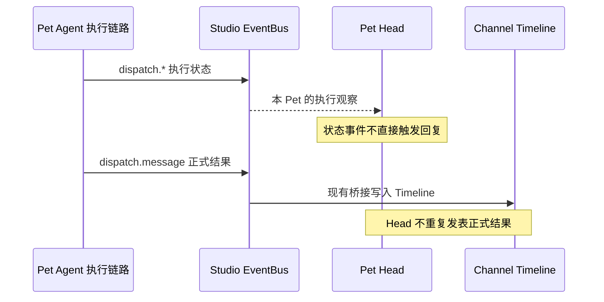

# Pet Head：判断、派发与反馈

状态：待评审，不开始实现。只调整 Head 的判断流程，不改变 Channel、Studio Dispatch 或 resident Pet Agent 的职责。

## 1. 总体结构

- **Channel Timeline → Studio EventBus → Head。** Human 和 Pet 写入同一条 Timeline；Channel 只在消息提交后发布 `channel.message.created`。在线 Pet 实例由自己的 Head 订阅 `source=channel, topic=channelId`，过滤自己发的消息。Channel 不替 Head 选消费者；live bus 不向离线 Head 补投。
- **Head → Channel port → Studio Dispatch → resident Pet Agent。** Head 做判断；现有 Channel port 校验成员和原消息、绑定 Session、传递附件和去重键；Studio 和 resident Pet 负责接纳、排队、执行与审核。
- **resident Pet Agent → Studio EventBus → 本实例的 Head。** Studio 已发布以 Pet 实例为 topic 的 `dispatch.*` 生命周期；本草案给 Head 加一条只观察的订阅。另有独立的只读 Session 访问，不用事件负载代替 Session。

## 2. 谁接，怎么处理

先确定这条消息是否归本 Pet。**当前消息里的有效 `@Pet` 已经明确指定了响应者**，只跳过「要不要接」的模型判断，不绕过 Head，也不意味着要派发或打断。没有明确点名本 Pet 时，Head 用职责和 Channel 上下文判断；不接就静默。能直接答的就直接答，不读 Session、不启动 Agent。

**每条消息只做一次处理决定。** 明确需要 Agent 做的工作，交给现有 Studio Dispatch。Session 已有执行时，不改正在跑的任务：问进度就只读那次执行，再回复；明确追加的独立工作走现有队列。只问进度不派发。

| 场景 | 行为 |
| --- | --- |
| 需要 Agent，Session 空闲 | 派发，不读取 Session 内容。 |
| 已有执行，用户问进度 | 读正在执行的那次，由 Head 据实回复。 |
| 已有执行，用户明确加一件独立工作 | 将独立工作提交现有 Studio 队列，不打断当前执行。 |
| 用户要求停止或修改正在跑的任务 | 首版不新增聊天打断，也不注入新材料。已有停止入口不变；Head 不声称已停止或已修改。 |

## 3. 忙时只查证、写回复

宿主只读本 Pet、当前 Channel、对应执行能公开的事实。`read_session` 是只读查证，不是新一轮任务决策。需要组织语言时，Head 拿原消息和已核实的事实，**只返回 `reply` 正文或空值**，不再选择工具、排队或派发。宿主用原 Channel 回复接口发回原消息。

例如「@Pet，A 做到哪了？另外帮我做 B」：第一次判断认出 B 是独立工作；宿主读 A 一次，回复步骤只说明 A 的实际进度，B 仍由原有 Studio 队列接纳。查不到 A 的可靠状态就如实说，不能把旧进度套到当前执行上。A 的计划和内部工具记录不是已完成的事实。

## 4. 分场景时序

### 4.1 指定对象、静默与直接回复

### 4.2 空闲派发

### 4.3 忙时追问与独立追加

### 4.4 执行通知与正式结果

## 5. 首版验收边界

- 被明确点名和主动接下消息，后续使用同一条 Head 路径。静默、直接答复和空闲派发都不读 Session 正文。
- 忙时同一条追问只查一次；只问进度不派发，独立追加只提交一次；写回复的步骤没有调度权。
- 只能使用当前绑定执行可公开的证据。查不到就不猜，A 的迟到结果不能拿来描述或操作 B。Head 的回复和 Agent 的正式结果各走原链路，不重复发。
- 不新增队列、通用工具循环、自动或聊天打断、主动长时提醒、历史事件重放或失败恢复。Channel、Studio Dispatch 和 Pet Agent 原有职责不变。
