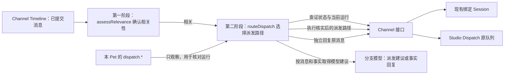
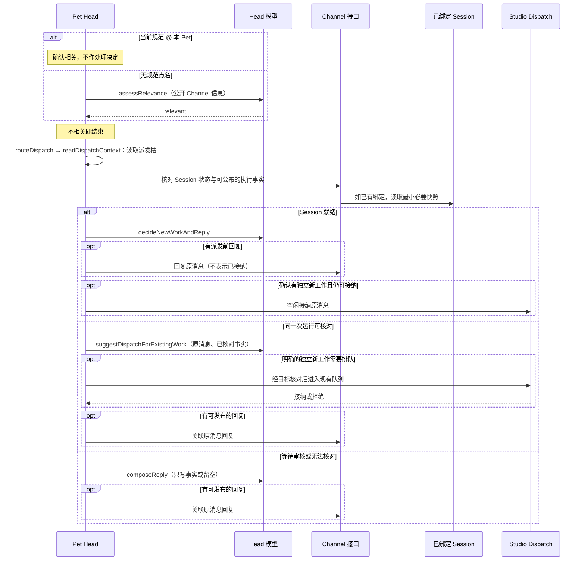
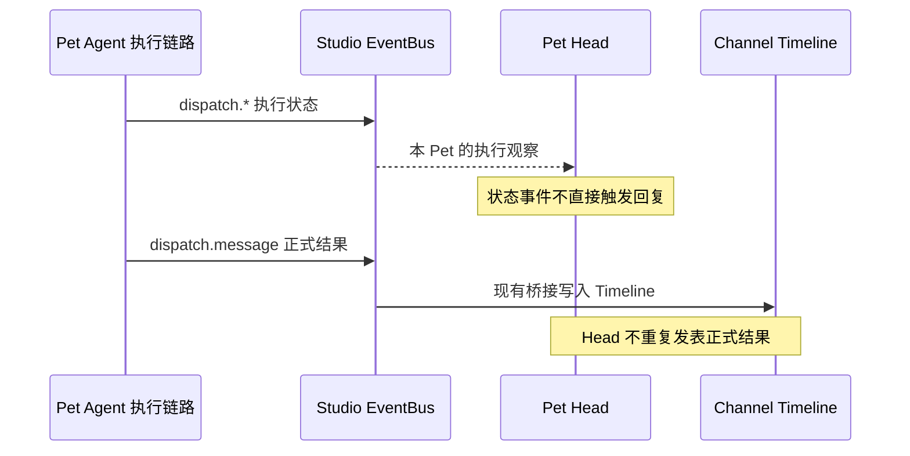

# Pet Head：判断、派发与反馈

状态：Head 组装和单客户端复用已实现，待评审。不改变 Channel、Studio Dispatch 或 resident Pet Agent 的职责。

首版（`a9b59036`）曾由 Studio Host 装配两个订阅，并分别懒建判断和写回复的模型客户端。现在每个在线 Pet 的 Head 自己管理两个订阅，共用一个懒加载的模型客户端。Host 只提供依赖，Pet 实例仍决定何时启动和停用 Head；不新增 Head 开关。

## 1. 总体结构

- **Channel Timeline → Studio EventBus → Head。** Human 和 Pet 写入同一条 Timeline；Channel 只在消息提交后发布 `channel.message.created`。在线 Pet 实例由自己的 Head 订阅 `source=channel, topic=channelId`，过滤自己发的消息。Channel 不替 Head 选消费者；live bus 不向离线 Head 补投。
- **Head → Channel port → Studio Dispatch → resident Pet Agent。** Head 做判断；现有 Channel port 校验成员和原消息、绑定 Session、传递附件和去重键；Studio 和 resident Pet 负责接纳、排队、执行与审核。
- **resident Pet Agent → Studio EventBus → 本实例的 Head。** Studio 已发布以 Pet 实例为 topic 的 `dispatch.*` 生命周期；Head 只观察本实例的执行状态，不因事件发消息。事件只用来绑定当前运行及已公开结果的消息 ID，不保留回复正文。查证经 Channel 授权后走既有只读 Session 入口。

**Head 的职责边界。** Head 随 Pet 实例启动，自己订阅归属 Channel 的 Timeline 和本实例的派发生命周期；停用时取消进行中的判断或回复并释放两个订阅。Host 不为每条消息逐步转交。Channel 仍负责原消息的校验、回复和派发入口；Studio 仍负责接纳；Session 仍提供现有只读入口。

## 2. 先确认相关，再选择派发路径

**第一阶段 `assessRelevance` 只确认相关性。** 当前消息经服务端解析的规范 `@Pet` 直接确立相关性；否则 `assessRelevance` 只返回 `{ relevant: boolean }`，不读 Session 或派发槽，不决定处理方式。规范点名不是工作授权。未通过则静默结束。Head 自动回复仍显示在 Timeline 中，但不触发其他 Head；用户引用它发出的新消息照常处理。

**第二阶段 `routeDispatch` 处理派发路径，回复单独发布。** `readDispatchContext` 先从运行时读取派发槽，再经 Channel 查证 Pet 的绑定 Session；槽空不代表 Session 就绪。首次无绑定且槽空时可以决定是否接纳，不为查状态创建 Session。对已存在的 Session 区分已就绪、可核对的运行、等待审核和无法确认；审核继续等不在普通派发槽的运行不当作可操作目标。Session 快照不能单独证明运行正在停止。

| 经查证的情况 | 后续处理 |
| --- | --- |
| 槽空且 Session 就绪 | `decideNewWorkAndReply` 判断原消息是否需要独立工作以及是否回复。提交前再核对空闲，Host 确认绑定 Session 可接纳后才开始。 |
| 本 Pet 的普通派发仍在同一次运行 | `suggestDispatchForExistingWork` 根据原消息与已查证的事实给出排队建议和可选回复。仅进度追问、补充上下文、裸 `@` 不派发。 |
| 等待审核或不能核对 | 不自动派发、排队或代替用户审核；可回复检查到的状态或说明无法确认。 |

排队复用 Studio 原队列，只适用于独立新工作，不将「现有工作成功后才做」或「停止现有工作改做另一件事」转成普通排队。Channel 消息和规范点名不携带停止授权；模型不能用它们打断或替换运行。运行时拒绝打断建议，不降级成排队或发送接纳回复。已有显式 Host 停止和派发入口不变。排队被接纳只证明收到处理请求，不证明工作开始或完成。

派发总是传入当前已提交的 `channel_message`，保留正文、作者、点名、附件和一层显式引用，不改写任务。引用、历史、计划和结果不是新的授权。没有正文无需回复；排队的确认只在接纳成功后发布。

## 3. 模型与事实边界

每个 Head 共用一个懒加载客户端。`pet_head_relevance` 只有相关性；就绪分支用 `pet_head_idle`，可核对的运行用 `pet_head_running`。JSON mode 给出格式示例，可省略无内容的 `reply` 并归一化为 `null`，但必须显式给出分支决定；原生结构化方法仍要求 `reply`。每个分支不补救、不重试、不切换格式。无法核对或不可操作时，`composeReply` 只写事实性正文或留空，不带调度权。

可读取的运行以同一归属 Channel、绑定 Session、当前请求和较早的公开来源为边界。带明确引用的消息不能用另一工作的状态冒充它所问的工作。模型只接收查证后的状态、已有计划条目和如有的同一次运行已经发表的公开结果；不得用 Session 私有正文、原始工具调用、内部请求 ID 或其他运行的输出。计划项完成或已有公开结果都不能证明整个运行已完成。计划可能早于该次运行；不能由活动标签推断正在执行的步骤。

正常相关性和处理保留当前消息之前最近 10 条公开消息，窗口外的显式引用只补一次。写入状态回复前复核同一次运行；等待审核仅指查证时看到的状态。

## 4. 当前分场景时序

### 4.1 至 4.3 两阶段处理

### 4.4 执行通知与正式结果

## 5. 首版验收边界

以下用例验证 Head 的行为，以及每次 Pet 激活只有一对订阅和一个按需创建的模型客户端。

- 被明确点名和主动接下的消息进入同一第二阶段；第一阶段不读运行状态。槽空但等待审核不算可接纳。
- 只问进度读一次核对到的运行，不派发。真正独立的后续工作可进入原队列；聊天打断建议不会影响任一 Pet 的运行，也不会降级入队。
- 只有已公开且属于当前核对运行的结果才作为执行事实。Head 回复和 Agent 正式结果各走原链路，不重发结果。
- 不新增队列、通用工具循环、主动长时提醒、历史事件重放或失败恢复，也不自动处理审批准入。Channel、Studio Dispatch 和 Pet Agent 原有职责不变。
