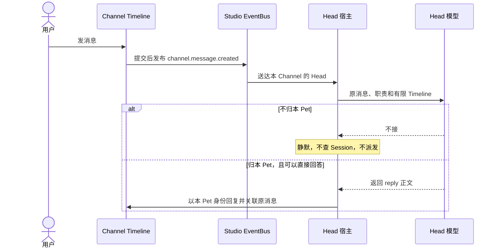
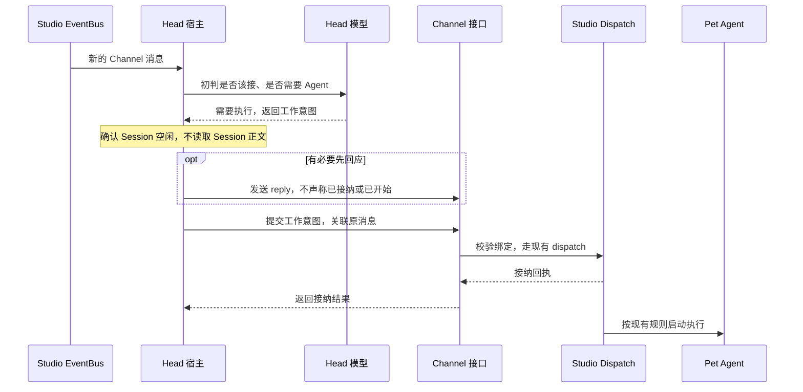
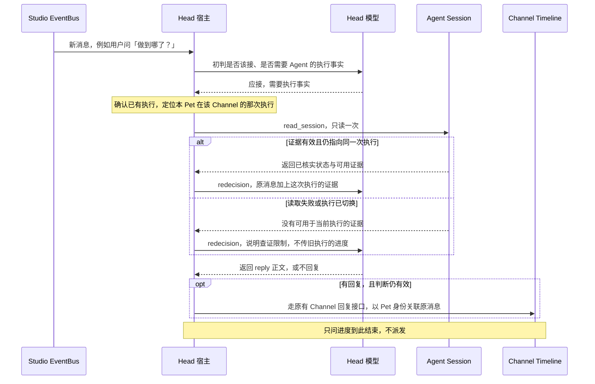
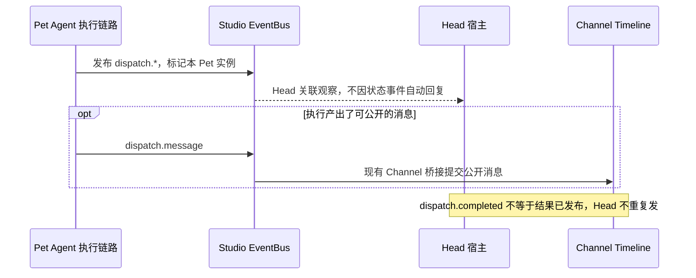

# Pet Head：判断、派发与反馈

状态：设计草案。只调整 Head 的判断流程，不改变 Channel、Studio Dispatch 或 resident Pet Agent 的职责。

## 1. 总体结构

- **Channel Timeline → Studio EventBus → Head。** Human 和 Pet 写入同一条 Timeline；Channel 只在消息提交后发布 `channel.message.created`。在线 Pet 实例由自己的 Head 订阅 `source=channel, topic=channelId`，过滤自己发的消息。Channel 不替 Head 选消费者；live bus 不向离线 Head 补投。
- **Head → Channel port → Studio Dispatch → resident Pet Agent。** Head 做判断；现有 Channel port 校验成员和原消息、绑定 Session、传递附件和去重键；Studio 和 resident Pet 负责接纳、排队、执行与审核。
- **resident Pet Agent → Studio EventBus → 本实例的 Head。** Studio 已发布以 Pet 实例为 topic 的 `dispatch.*` 生命周期；本草案给 Head 加一条只观察的订阅。另有独立的只读 Session 访问，不用事件负载代替 Session。

当前实现：[Timeline 写入](../../../plugins/channel/src/channelService.ts)、[Channel port 与输出桥接](../../../plugins/channel/src/channelPlugin.ts)、[Head 与执行器](../../../packages/studio/src/host/petHead.ts)、[Studio 装配](../../../packages/studio/src/host/buildStudio.ts)、[EventBus](../../../packages/studio/src/studioEventBus.ts)、[Studio Dispatch 与 Session 入口](../../../packages/studio/src/createStudio.ts)、[Resident Pet Dispatch](../../../services/host/src/host/residentPetDispatch.ts)。

## 2. Head 先判断是否该接，再看 Session 状态

先用本条消息、Pet 职责、明确引用的消息和有限的 Channel Timeline 判断「归不归我」。**不接就是静默**：不回复、不读 Session、不派发。Head 能直接回答的，就直接决定是否回复；不为了回复而启动 Agent。

当 Head 需要让 Agent 做事，或需要知道此刻已有执行的情况时，宿主给出该 Session 的状态事实。**对需要 Agent 处理的请求，只按 Session 状态分两条路径：**

| Session 状态 | 当前路径 |
| --- | --- |
| 空闲（idle） | **`dispatch`**：把已确认需要执行的工作交给 Studio，不先读 Session 内容。 |
| 已有任务在执行 | **`read_session`**：先查正在执行的那次，拿到事实后让 Head 做判断；不在这一步直接另起执行。 |

这不是让模型先选「查进度」或「要派发」。例如，「上次那份表做到哪了？没做完就换新表」在已有执行时，先查那次执行，再判断怎么回复、以及是否有工作需要提交。只有询问、没有执行请求时，查到事实就据实回应；没有正在执行的任务也不会因此派发一个任务。

## 3. 工具边界与读取后的判断

- **`dispatch` 是执行，`read_session` 是查证。** 宿主按 Session 状态选择当前路径，不让模型同时拿两个能力猜状态。首版可以用结构化决定加宿主编排，不必引入通用 ReAct。最终决定只表达回复或工作意图；回复与派发可以独立发生，不要求每次派发都先回复。
- **只读当前这次。** 宿主用已核实的 Pet、Channel、Session 与 `invocationId` 定位，必要时用生命周期与 `activeRun.requestId` 核对具体运行。模型不传任意身份或查询参数。定位或读取失败，就是这次查证拿不到可靠证据，不把它解释成空闲、没完成或已完成。
- **读完再决定。** 可以据实回复；有已提交且可核实的结果明确满足新请求，就不重复派发；独立的后续工作仍走现有 Studio 接纳。针对当前执行的更正，只有能作为独立后续任务才提交；必须改正在跑的那次，第一版不自动打断，也不声称已改。正在跑、类似的计划或单个 `completed` 事件，都不能证明新请求已满足。
- **Queue 仍由 Studio 管。** Session 状态决定 Head 此时走哪条路径；实际开始还是排队由现有 Studio 接纳规则决定。无需 Head 自己维护队列。

## 4. 上下文按步骤给，不把整个 Session 交给 Head

1. **初判只看 Channel。** 原消息、Pet 职责、用户明确引用的原文和有限 Timeline。不给整份实例配置、队列明细或原始附件内容。宿主用轻量运行事实判定路径，不为判断空闲去拉完整快照。
2. **只有走读取路径，才补给执行证据。** 复用 Studio 的 `petSessions.snapshot`。给模型可核实的状态、观察时间、必要的原任务摘要，以及能确认属于本次执行、可在本 Channel 使用的消息或已公开结果。无法核实的字段省略，并明确查证限制。宿主保留运行关联 ID 供复核。即使活跃 `requestId` 匹配，也不把没有运行来源的旧计划当作本次进度。不给 TUI 私聊、原始工具输入输出、私下审批或未交接的子 Agent 内容。
3. **限制读取和判断次数。** 每条消息最多两次 Head 模型适配器调用（含格式回退）、一次 Session 读取，共用判断截止时间。读取前后核验绑定及访问权限，迟到结果不生效；A 已变成 B 时，不拿 A 的快照描述或操作 B。初判无有效意图不派发；查证不成时，只有已确认可独立执行的工作才能走现有接纳，依赖当前执行的更正不盲目提交。

现有入口：[队列与 Session 接口](../../../packages/studio/src/studioContract.ts)、[精确 Session 适配器](../../../services/host/src/host/residentPetSessions.ts)、[snapshot 投影](../../../services/host/src/conversation/agentSessionSnapshot.ts)、[Head 判断适配器](../../../packages/studio/src/host/petHead.ts)、[EventBus FIFO](../../../packages/studio/src/studioEventBus.ts)。图中的 `read_session` 表示这条受限只读路径，不代表通用 Session 工具。

## 5. 反馈分别走现有链路

- **接纳与执行变化**：Studio 接纳回执回答是否接纳；已有 `dispatch.*` 经同一个 EventBus 到本实例的 Head。Head 只保存少量可关联的观察。事件可以帮助查证，不能覆写实时快照，不因为收到状态事件就直接回复。主动长时提醒和失败恢复另做，不在这版引入调度机制。
- **用户追问进度**：它是新的 Timeline 消息，先过同一个职责判断。已有可定位的执行时，Head 沿 `read_session` 查证，明确区分「还在跑」「等待输入」「已停止」「失败」和「目前查不到」。若用户同时追加或更正工作，仍按派发冲突的规则判断；同一消息复用读取结果，不再读第二次。
- **执行的公开回复**：继续走 resident `dispatch.message` → 已有 Channel 桥接 → Timeline。Head 不从完成事件再发同一结果，不转发未公开的中间内容。派发接纳、执行完成、结果发表是三件事。

## 6. 分场景时序

总体结构图说明各组件之间的关系；下面按消息到来后的实际顺序，区分 Head 的判断、Studio 的派发，以及谁向 Channel 写消息。`Head 宿主` 是现有 Head 的运行代码，不是新增服务。`redecision` 指同一条消息的第二次模型判断，不是独立工具，也不是重跑 Agent。

### 6.1 不接，或 Head 可以直接回答

### 6.2 需要 Agent 执行，Session 空闲

### 6.3 已有执行，先查证，再由 Head 回复

**`reply` 是判断结果中的正文，不是第三条 Session 路径，也不是模型再调用一次的工具。** 复判有话要说，就给出 `reply` 正文；没有就留空。Head 宿主校验这次判断仍可提交后，复用现有 Channel `reply`，以本 Pet 的身份写入 Timeline，`replyTo` 指向本次用户消息。Agent 不代写这条回复。若用户同时新增工作，独立的后续请求才可在复判后走现有 Studio 接纳；这不等于在读取时直接另起执行。要修改正在跑的那次，首版不自动打断。

### 6.4 执行事件与正式结果返回

## 7. 第一版验收

- 忙时收到不归本 Pet 的消息：零 Session 读取、零回复、零派发；普通直接答复不读 Session。
- 空闲且需要执行时派发，不读 Session 内容；已有执行时先读正在执行的那次，不直接另起执行。跨 Channel 不允许读外部 Session；仅问进度不产生新运行。
- 命中当前执行才查证；确认覆盖与仅有相似计划分别验证；A 在复判前失败、复判后才失败、或同一 Session 已切到 B，都不会因旧证据静默吞掉独立的新请求，也不会操作 B。
- 当前更正不能独立执行时不自动打断、不夸称已修改；晚到的事件不能覆盖实时观察，执行的公开回复不重复写入。
- 格式 fallback 不突破两次调用；用脚本模型模拟慢调用、慢快照、实例下线及绑定变化。验证同一 Head 的下一条消息按时推进，且晚到结果不会提交回复或派发；其他订阅者不受阻。

非目标：新增调度器、Head 队列或第二套总线；替换 Studio Dispatch；让 Pet Agent 反向依赖 Head；修改 resident Agent 的执行、审批和中断接口。
