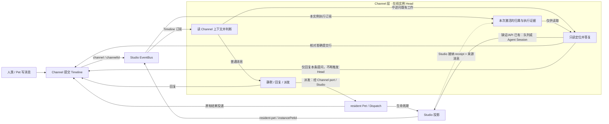

# Pet Head：连接 Channel Timeline 与 resident Pet 的执行状态

状态：设计草案，供实现与评审。主线是在线 **Pet 实例的 Head** 如何在 Channel 层连接对话和执行。用户中途询问进度只是使用这份知识的一条分支，不是知识采集的触发器。

## 1. 两条独立事件轨道，一个在线 Head

每个在线 Pet 实例在所属 Channel 中有一个 Head。两条轨道使用同一个 [Studio EventBus](../../../packages/studio/src/studioEventBus.ts)，但订阅、职责与证据不可互换：

- **Channel Timeline 轨道**：Channel 提交消息后发布 live 通知（`source: channel`，`topic: channelId`）。Head 订阅所属 Channel，以当前 Pet 成员权限读上下文，决定静默、回复或通过 Channel port 派发。Timeline 是对话与已提交回复的事实来源。
- **resident Pet 执行轨道**：Studio 将 resident 生命周期投影成 `dispatch.*`（`source: resident-pet`，`topic: instancePetId`）。Head 精确订阅本实例，只将确认属于自己的 invocation 归并为执行知识；不调用判断模型、不发消息、不触发派发。事件可证明执行状态，不能证明 Channel 已提交结果。
- **按需读取**不是第三条事件轨道。需要补证时，Head 读取 Studio 已有队列或 Agent Session 快照；核对公开交付则通过 Channel 的受权内部读取。快照不创建归属，不能代替 live 接纳关联。

EventBus 仅保证同一订阅者的交付顺序，不回放离线事件，也不保证两个订阅之间的顺序。Head 随实例激活、关闭和替换；关闭释放两条订阅、暂存证据与未发布答复。重开不从队列、Session 或 Timeline 反推旧归属。Studio、Channel 和 resident 保持职责划分：Channel 不接入执行观察来驱动判断，Pet Agent / Host 不知道 Head，不新增 EventBus 格式、外部 Dispatch 字段或 Agent Session 协议。

## 2. 以派发接纳建立归属

Head 继续使用 [Channel port](../../../plugins/channel/src/channelPlugin.ts) 派发。通过进程内观察接缝，在 resident 接纳前登记 Studio 刚分配的身份，关联 `(petId, channelId, sourceMessageId) → invocationId`。[Studio](../../../packages/studio/src/createStudio.ts) 以同一个值作为 resident `dispatchId`；只有相同 Pet、相同 ID 的成功 Studio receipt 确认归属。receipt 不是运行句柄。Studio 的接纳与 Channel 的 `confirmSession` 是两步；后者失败不抹去已接纳证据，也不重派。幂等回放不重新登记或接管旧 receipt。

只暂存刚分配且尚待确认的 invocation 的提前事件；接纳失败即丢弃。每条事件先核对精确来源和 topic，再核对 `payload.petId`、`scope = { namespace: 'channel', id: channelId }` 和已登记的 `payload.invocationId`；已知 Session 与传入 `sessionId` 冲突时丢弃。其它生产者（含同 Pet、同 Channel、同 Session 的 Trigger、Scheduler 或人工派发）不会被认领。`requestId` 是一次执行轮次的身份，不是 invocation 的替代；除了接纳后的排队事件，归并状态需要该轮次标识。人工审核后的现有[续跑路径](../../../services/host/src/host/dispatchContinuation.ts)可在同一 invocation 上开启新的轮次。

| 可信事件 | Head 记录的事实 |
|---|---|
| `dispatch.queued` / `dispatch.running` | 排队 / 正在运行；迟到的 queued 不能覆盖 running 或 waiting。 |
| `dispatch.waiting` | 等待。只有 [`pendingInterrupt.payload.kind === 'human_review'`](../../../packages/agent-session/src/review.ts) 能证实等待人工审核；不公开审核详情。收到后续不同 `requestId` 的可信 running 才更新轮次；旧轮次的状态不回盖。 |
| `dispatch.completed` / `dispatch.failed` / `dispatch.interrupted` | 执行结束 / 失败 / 已中断；终态不回退。Host 的[图预算回退](../../../services/host/src/agent/chatSessionAdapter.ts)也可能以 `completed` 返回限额提示或部分回复，因此该事件不是任务成功、验收通过或交付物齐全的证明。 |
| `dispatch.message` 携带 assistant 的 `message.completed` | 只保留本轮 Agent 消息 ID 供后续核对；不提升状态、不保留内容。 |

同订阅内串行归并，不用墙钟重排。重复事件或没有新增证据的同阶段通知不刷新观察时间。每次激活最多保留 32 个待接纳/非终态关联、最近 32 个终态关联；每项最多保存最近 32 个已见事件 ID、最近 8 个输出引用，接纳前暂存最多 16 条投影。暂存溢出后不能把剩余的非终态视为当前证据；新可信事件可补上缺口。容量满仍照常派发；若有接纳工作无法跟踪，本次激活的候选集合不全，不做隐式选择。终态淘汰、缺证据或重开不等于工作不存在。

## 3. 按需补证：队列或既有 Agent Session

先有已接纳且归属匹配的记录，再读快照。既有判断路由仍读取一份队列视图；进度分支只复用当次仍新鲜的队列快照，或补读一次 Agent Session。不巡检、不重试、不补发、不新增 Session 读取协议。快照读取期间若收到新可信事件，以新事件归并后的证据为准。

- **队列**：非终态缺证据或上次可信证据超过 30 秒、尚无精确 Session/轮次，或只需补证排队时，可读取已有 [`listDispatchQueues()`](../../reference/api/studio.md#global-dispatch-observation)。只保留 Pet、Channel scope、原消息 origin、`dispatchId` 全匹配且 Session 不冲突的一项。精确 `activeOperation === 'dispatch'` 的 `activeDispatch` 可证实运行；精确 `entries` 可证实排队。全局 waiting/blocked 不能证实某一项在等人工；队列缺项不证明它已结束。
- **Agent Session**：有精确 Session 与当前 `requestId`，且需要更细进展时，复用 [`petSessions.snapshot(petId, sessionId, { timelineLimit })`](../../../packages/studio/src/studioContract.ts)。先由 Channel 核对当前成员、实例归属和 Session 绑定，然后核对返回的 `sessionId` 与 `activeRun.requestId`。精确匹配的 `activeRun` 只补证运行。当前 `currentPlan` 没有自身的轮次归属，可能仍是上一轮 checkpoint 的计划；[初始 `plan.updated`](../../../services/host/src/agent/chatSessionAdapter.ts) 也可能把它标为新 `requestId`。首期不使用这些计划或初始 activity 推断阶段，不声称第几步、百分比或预计时间。读取请求限制近期 `timelineLimit`；Host 可能额外保留未结轮次的条目，因此响应不转发整份快照。首期不读取这些条目的内容。后续只有有界、显式匹配轮次且可公开的既有投影才能提供阶段证据。
- **Capability 边界**：子 Agent 的内部工作不可见；Root 工具历史出现 `delegate_capability`、甚至其调用状态为 completed，都不证明某个交接物可见、获批或已投递。[Transcript 投影](../../../services/host/src/conversation/transcriptProjection.ts)只可能把验证过的返回作为同轮最终回复的引用；[Host 快照的 checkpoint Timeline](../../../services/host/src/conversation/agentSessionSnapshot.ts)目前没有逐条填充 `requestId`。不能凭顺序、工具名或原始结果补这个缺口。没有同时满足公开与轮次归属的阶段摘要时，只用现有可信状态；不为隐藏内容另建抽取、投影或管道。不把工具参数/结果、审核内容、计划任务原文、整份 Session 或全局队列传给模型或发到 Channel。

读取失败但仍有新鲜且未被否定的生命周期证据时，可以回答该状态，不冒充已知具体步骤。证据过时或精确绑定的快照与其冲突时答当前未知；有可信旧观察才注明上次所见。不据此接管派发或变更工作。

## 4. Timeline 分支：回答中途提问

在已有 [Head 判断](../../../packages/studio/src/host/petHead.ts) 中识别明确询问既有工作的意图，区分只问状态、想看细节，以及还要求开始、修改或中断的混合请求。状态分支只读，不派发、不打断、不替人审核；混合请求请拆开。仅提及 Pet 不触发状态分支。模型不提供可信任务 ID、进度事实或交付证据。

1. **确定唯一 Pet**：使用消息中单一解析出的 Pet mention，或同 Channel 精确 `replyTo` 指向的 Pet 作者；两者均无时，只有 Channel 恰有一只 Pet 才可答。多个目标或身份冲突时不抢答；名称和正文不替代身份。
2. **确定归属任务**：有 `replyTo` 就查该条已提交消息是不是已跟踪的原始来源。同 Pet 的普通 Head 确认允许向上查一跳：核对作者与 `head-reply:<原来源 ID>`，要求上级是同 Channel 已跟踪的原来源；不向上递归或把上次进度答复认作原任务。显式引用无效不回落。无引用时仅在本次激活有唯一可证实的非终态且未辨清候选为零时选它；否则请引用原消息或答无法确认。
3. **单独核对交付**：对可信完成运行，如有同轮 Agent 消息引用，由 Channel 验证当前成员、实例归属，再按 `channel_id + Pet 作者 + 准确 external_ref` 查已提交 Timeline 行；**仅**返回匹配的 Timeline 消息 ID。该内部读接缝位于 Channel，不新增数据表或公共端点。现有[投递路径](../../../plugins/channel/src/channelPlugin.ts)以 Agent 消息 ID 写 `externalRef`，现有[重复写入唯一键](../../../plugins/channel/src/store/kysely/store.ts)本身不含 Channel，不可直接用作查询。排除 `head-reply:` 保留前缀，写入延迟、写失败或不匹配只说明交付尚未确认；出现早先回复不把失败/中断变成成功。
4. **正常提交答复，但不再交给 Head**：通过现有 Channel port 回复本次提问，沿用 `head-reply:<提问 ID>` 去重，不带 Pet mention。由 Channel 在首次提交的 live 事件上，用进程内 Symbol 标记这类答复和澄清，不进入 SSE JSON；仅可信 Head reply 选项可设置该标记，公开请求与正文不能设置。Head 在判断前跳过标记事件，其余订阅者仍收到正常提交的消息；不改变持久 Timeline 格式。

例如，「执行已结束，尚未确认回复已发到本 Channel」与「执行已结束，已在本 Channel 留下回复」是不同结论。后一种依据精确 Timeline 消息核对，但首期答复不回传内部引用，也不宣称工作成功或全量交付。没有主动播报、计时巡检、自动重试、补偿派发或重启恢复。

## 5. 验收

| 场景 | 预期 |
|---|---|
| 同实例两轨并行；receipt 前早到、接纳拒绝、Channel 确认失败、幂等回放 | 只归并此激活实际接纳的 invocation；确认故障不抹去接纳；普通回复和派发行为不变。 |
| 外来 invocation、其它实例/Channel、重复事件、续跑换 `requestId`、非人工审核等待 | 不认领、不回退、不刷新旧信息、不误报审核。 |
| 纯进度、混合请求、两只在线 Head、重复提问投递、无效引用 | 只让合法目标答复或澄清；不派发、不打断；回复不唤起其他 Head，不重复提交。 |
| 队列或 Session 错配/缺项、过期证据、不同轮次计划、隐藏工具结果 | 最多一次补证；不泄漏全局数据、猜阶段、误把 handoff 当审核或交付。 |
| 完成含预算回退、输出写入延迟或失败、交叉作者与 Channel | 结束不等于成功；只有精确已提交行能证明已留下回复。 |
| 缓冲/容量满、关闭、替换、重开 | 缺证保守答复；不让未发布答复越过关闭；不恢复旧归属。 |
