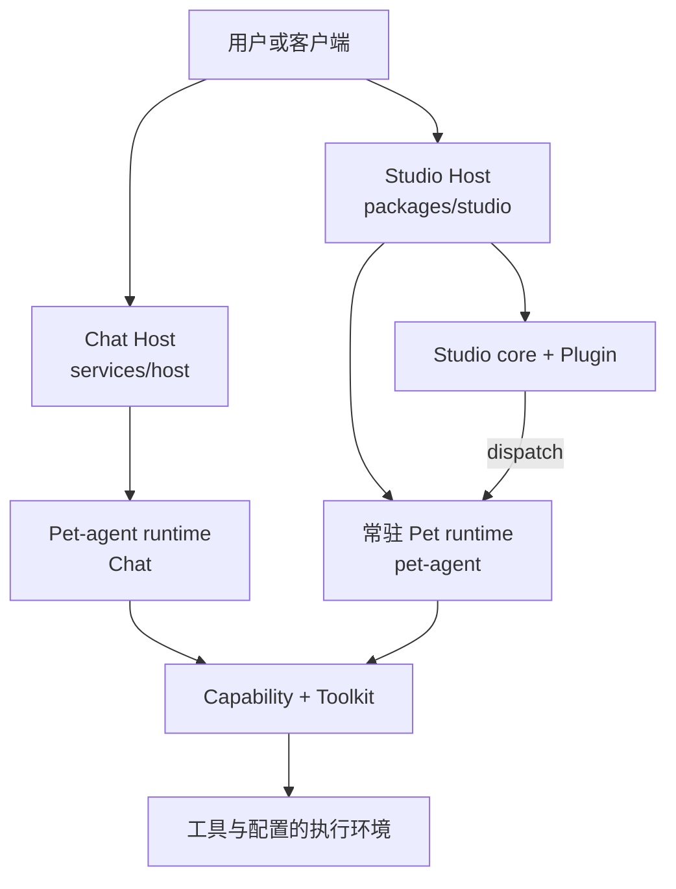

# 架构

> **状态：当前架构指南。** 本页描述设计选择与实现边界，不代表项目理念已经全部确定；见[核心理念讨论](principles-discussion.md)。类型与协议细节由 [Reference](../reference/index.md) 中的页面维护。

[English](../../concepts/architecture.md)

PinPawo Agent 将编排、任务权限、工具执行、人工审核和持久状态分开，使每个边界可以独立演进并保持可观察。

## 设计目标

项目以 `pet-agent` 已实现的可靠单 Agent 机制为基础组织 Studio。当前设计包含以下机制和边界，并在实践中持续演进：

1. **用户保持控制：** 本地工具和浏览器 session 不离开运行 Agent 的机器；高风险操作可等待审核。
2. **权限可见：** Capability 静态声明 Toolkit 依赖，单个任务的工具面是明确的。
3. **支持多步骤工作：** checkpoint、结构化事件和 session snapshot 支持断线、审核与恢复。
4. **组织和扩展能力：** Capability 描述任务并绑定提供工具和策略的 typed Toolkit。
5. **通过 Studio 组织工作：** Studio 使用 Pet runtime 和 Plugin；Plugin 提供添加业务行为的方式。

## 系统地图

Chat Host 与 Studio Host 是独立的装配入口。二者复用 Host 装配能力和 `pet-agent`
机制；Studio Host 创建常驻 Pet runtime 并将其连接到 Studio。上图展示角色，不表示
它们共用同一个 runtime 实例。

Host 解析配置并装配 Capability 和 Toolkit。Toolkit 可以声明执行环境依赖，由 Host
注入 RS 实例；多个 Toolkit 可以共享同一个 RS。详见 [RS 契约](../../reference/extensions/toolkit-rs.md)。
与机器无关的编排位于 `packages/pet-agent/`，Host 集成留在 `services/` 和 `toolkits/`。

Agent 侧的关系是 `Host -> Agent Runtime -> Capability -> Toolkit`：Capability 选择
Toolkit，Tool 定义属于 Toolkit。RS 是注入的依赖，不是 Toolkit 所有的 runtime；
orchestrator 和 subagent lane 是 Agent 内部实现。详见[领域关系设计](../../design/host-agent-capability-toolkit.md)。

完整 Studio 进程入口 `pinpawo-studio` 位于 `services/studio/`，发行包包含六个基础
Plugin；核心 `@pinpawo/studio-core` 位于 `packages/studio/`，具体 Plugin 通过
`StudioPluginResolver` 注入。Plugin 可以提供 Toolkit，Capability 则由 Host 单独装配。

## 扩展模型

项目有两个相互配合的扩展方向：Studio Plugin 提供业务行为的插拔；Capability 和
Toolkit 负责能力的组织和扩展。Capability 声明任务和 Toolkit 权限，Toolkit 提供工具、
可用性和审核策略。详见[扩展契约](../reference/extensions/capability-toolkit.md)和
[Studio](../studio/index.md)。

## 状态归属

| 状态 | Owner | 规则 |
|---|---|---|
| 对话消息和待继续执行 | LangGraph checkpoint（配置时） | resume 与审核的持久权威。 |
| 当前客户端视图 | Session projection | 物化视图，不是第二份对话存储。 |
| Capability 草稿与工具过程 | Subagent lane | 私有、短生命周期。 |
| 委派结果证据 | Checkpoint messages | typed 执行记录保存交付；私有工具过程留在子图。 |
| 本地配置 | local host + workdir | 在创建 runtime 前解析。 |
| Studio dispatch 投递 | per-Pet invocation queue | 队列仅在进程内；active thread 与 checkpoint 连续性属于 resident Pet 的 Agent Session。 |

## 下一步

旧 Capability Artifact Pipeline、无生产用途的 state 索引和 Channel 附件 API 已退役。
执行记录只支持现行 schema；自测阶段仅在用户明确要求时处理历史 checkpoint 兼容。
详见[退役说明](../../reference/extensions/capability-toolkit.md#7-旧-artifact-pipeline-退役)。
本次清理不提供文件发布或发现能力；后续目标仍见
[Session Artifacts 草稿](../../design/agent-runtime/session-artifacts.md)。

- [快速开始](../guides/getting-started.md)
- [核心概念](core-concepts.md)
- [API 参考](../reference/api/index.md)
- [Studio](../studio/index.md)
